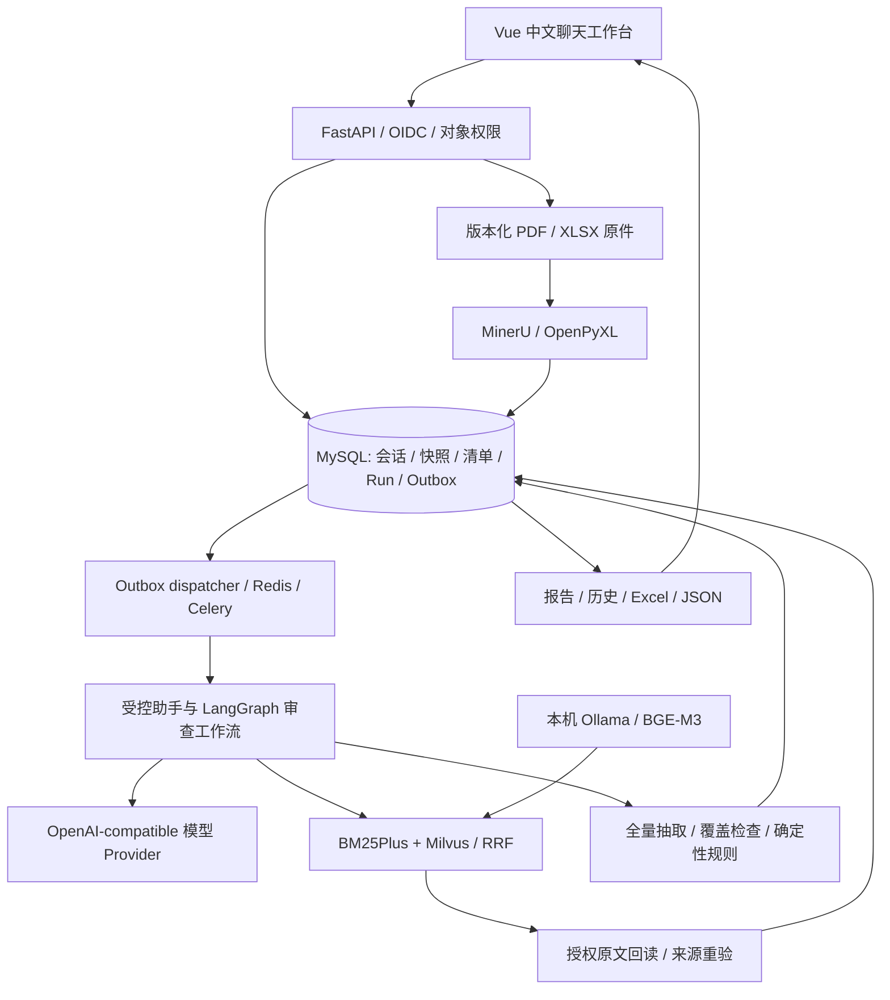

# DocuCheck · 采购文档审查 Agent

[](https://github.com/YanShui9/docucheck/actions/workflows/offline-ci.yml)


**把采购需求、供应商报价与承诺材料，整理为可追问、可回到原文、可人工复核的审查结果。**

DocuCheck 是一个以中文聊天为入口的个人开发项目。用户可以先描述采购需求，也可以上传 PDF / Excel；助手整理动态审查指标，由用户保存并明确确认，再对供应商资料进行核验。报告保留资料版本、事实来源、冲突和未完成范围。

项目处于评测收尾阶段，已冻结新增业务功能。指定修复闭环已通过，10月14日多品类开发测量也已完成；正式核验的处理完成与严格证据评分尚未达到质量出口，继续优先修复失败链路。尚未提供公网在线试用。[当前计划](docs/superpowers/plans/2026-10-13-project-consolidation.md)列出证据和剩余条件。

评测后已补候选级语义修复反馈、重复枚举表头、未来承诺保护及同批材料分组引用。10月15日按用户确认的保守口径，新绑定审查使用v12：正文识别尚未独立验证，所有肯定presence候选暂保留待人工确认，即便有材料引用组；明确未提供、冲突及未完成覆盖继续分别处理，旧v8/v9/v10/v11历史规则与身份保留。当前源码全量2054 passed/52 skipped/网络0，前端221项及类型/构建、依赖/Ruff与两阶段复审通过。这会减少自动满足，不代表已经实现正文识别；修复尚未部署或真实模型复测，原质量成绩保持不变。验证与剩余条件见[评测说明第14节](docs/evaluation.md)。

**快速浏览：** [架构与设计取舍](docs/architecture-and-interview.md) · [十分钟演示](docs/interview-demo.md) · [测试与评估证据](docs/evaluation.md) · [安装与运行](docs/reproduction.md) · [全部文档](docs/README.md)

## 解决什么问题

采购审查通常要在需求书、报价表和规格说明之间反复核对：数量是否一致、单价是否含税、承诺交期是否符合要求、多个文件是否互相矛盾。直接让模型回答，还需要处理来源不准确、漏读资料、旧结论混入新版本等问题。

DocuCheck 将模型理解、原文验证和规则比较拆开处理：模型负责意图识别和事实候选，服务端负责权限、版本、证据覆盖及正式结论。需求不足时保留待确认事项，资料冲突时展示双方依据。

## 用户怎么使用


**指标随采购任务变化。** 水果采购可以设置数量、规格、单价与交期；手机采购可以设置型号、容量、版本与质保；服装采购可以设置尺码、面料和数量。用户可自行编辑，也可从文字需求或订单中提出候选。未明确的数值不由助手补写，复杂条款可设置为人工核对。

早期固定八字段的设备样例保留用于回归测试；当前动态清单不以这八个字段限制用户。

## 界面与来源复核

下图来自 **2026-10-08 的真实本地浏览器验收**，使用合成苹果采购资料，无真实商业数据。展示的是该次验收的界面与历史结果；最新资料与品目对应的指定合成闭环已完成，见[2026-10-11验收记录](docs/document-item-binding-c-acceptance-2026-10-11.md)。下图仍为10月8日的历史截图。

| 按任务指标查看报告 | 回到报价原文核对 |
| --- | --- |
|  |  |

## 核心设计

| 能力 | 实现方式 |
| --- | --- |
| 有边界的 Agent | LangGraph 工作流、LangChain 模型适配、受控工具、调用与时间预算；正式审查有服务端覆盖约束。 |
| 动态审查清单 | 数值、金额、枚举、资料存在、期限、人工核对六类规则；稳定品目与指标 ID，草稿和确认版本分离。 |
| 中文混合 RAG | 本机 Ollama / BGE-M3 + Milvus 向量检索，与 BM25Plus 通过 RRF 融合；从授权原文回读引用。 |
| 上下文与记忆 | MySQL 保存原始会话、版本化任务状态、历史摘录和用户明确保存的有限偏好；按阶段加载工具与必要内容。 |
| 来源与业务判定 | PDF 页码 / XLSX 单元格、文件哈希、单位与口径验证；确定性规则输出结果，不用 top-k 未命中证明缺项。 |
| 异步可靠执行 | MySQL Run / attempt / fence、事务 Outbox、Redis / Celery，支持幂等提交、取消、澄清与受控重试。 |
| 人工复核 | 只允许修正有原文支持的提取事实；保留原件、旧版本与审计，不允许直接把结论改成“满足”。 |
| 身份与资源权限 | Keycloak OIDC / PKCE、API 令牌验证与项目成员权限；模型不能指定身份或跨任务读取。 |



具体调用流程、上下文预算、向量索引一致性和失败恢复见[架构说明](docs/architecture-and-interview.md)。

## 已验证的成果

以下数字绑定各自的日期、资料与代码版本，不能相加，也不能将历史设备开发集分数解释为当前多品类泛化准确率。

| 验证范围 | 记录 | 证据与限制 |
| --- | --- | --- |
| 2026-10-10 后端源码离线回归 | **1438 passed / 48 skipped，网络请求 0** | [A3 验收](docs/document-item-binding-a3-2026-10-10.md)；跳过的集成项单列，测试数量不代表业务准确率。 |
| 2026-10-10 品目范围后端实连 | 隔离 MySQL **16 项**、真实 Milvus **3 项**通过 | 同上；Milvus 使用合成向量验证过滤与排序，没有验证本轮 BGE 或大模型端到端效果。 |
| 2026-10-10 品目对应前端 | **218 项**前端测试、类型检查和构建通过；相关后端契约 **31 项**通过 | [B 交付](docs/document-item-binding-b-2026-10-10.md)；组件与进程内 API 测试，业务迁移和真实浏览器 / 模型验收待完成。 |
| 2026-10-11 品目对应运行验收 | 手机重审保留人工复核；水果/服装4项正式审查、苹果范围混合检索、历史只读和JSON/Excel通过。最终后端 **1583 项通过/48跳过**、前端 **221项通过** | [C闭环验收](docs/document-item-binding-c-acceptance-2026-10-11.md)；保留失败与显式重试，合成开发场景不代表独立质量或生产发布。 |
| 2026-10-13 关键缺陷修复 | `aeac267` 工作区离线 **1793 passed/48 skipped/网络0**；MySQL 8.4.11/RR 隔离验收 **13 passed/0 skipped**，0018迁移往返通过 | [收尾计划](docs/superpowers/plans/2026-10-13-project-consolidation.md)；临时数据库与脚本Provider，不代表模型准确率。 |
| 2026-10-13 修复服务应用 | 运行源码 `41eb967`/0018，四后台129份文件哈希一致；六类规则11项已见合成状态符合预期，paper范围hybrid/回读/原件及新旧JSON/Excel通过 | [服务验收](docs/repair-consolidation-b-services-2026-10-13.md)；保留两轮核验未完成及显式重试，最终含批次缓存；独立集0。`4eb46dd`工作区全量1793 passed/52 skipped/网络0，后续人工提示细化205项定向通过；不相加，不代表质量或生产发布。 |
| 2026-10-14 当前开发测量 | 12包/104位置，配置修正及显式恢复后6包completed、严格3/12；完整Run口径状态46/104、必要证据39/82。24问检索中20有答案，BM25/dense/hybrid Recall@5为85%/92.5%/82.5%；附加Agent场景7/8 | [评估边界](docs/evaluation.md)、[机器摘要](evals/reports/dynamic-development-2026-10-14.json)；未完成保留分母，作者已见/独立0，不是首次成功率或泛化准确率。最终离线1829 passed/52 skipped/网络0，定向179项，不相加。 |
| 2026-10-08 聊天式 RAG | 两轮真实页面 / 队列 / BGE-M3 / Milvus / DeepSeek 问答 | [RAG 实连](docs/repair-browser-rag-live-2026-10-08.md)；4 次模型调用，来源与同任务上下文恢复已核对。 |
| 2026-10-03 设备合成开发集 | **12/12 任务、104/104 状态、89/89 必要证据**；危险误判满足 0 | [开发验证](docs/m5-current-version-integration-2026-10-03.md)；作者已见、AI 复核，独立封存 0，属于历史固定字段版本。 |

GitHub Actions 的实际状态见顶部徽章；本地报告、远程 CI 和真实模型评估各自说明覆盖范围。[评估说明](docs/evaluation.md)保留失败记录、分母和复现方法。

## 快速验证：不需要模型密钥或 Docker

以下为 Windows / PowerShell 命令。在新目录克隆并创建环境；已有工作区无需重复创建。

```powershell
git clone https://github.com/YanShui9/docucheck.git
Set-Location docucheck
conda create -n docucheck-repro python=3.12.14 pip -y
conda activate docucheck-repro
python.exe -m pip install --no-deps -r backend/requirements-dev.lock.txt
python.exe -m scripts.verify_offline --report data/verification/first-run.json
```

后端脚本检查依赖、Ruff 和离线测试，并阻止测试意外访问真实服务；Windows 需要可用中文字体，其他平台见[复现手册](docs/reproduction.md)。报告路径须使用未存在的新文件。

```powershell
Set-Location frontend
npm.cmd ci --ignore-scripts
npm.cmd test
npm.cmd run build
```

前端使用 Node.js 24。完整网页演示还需 MySQL、Redis、OIDC、解析进程和后台 worker；启用语义检索另需 Milvus 与本机 Embedding。模型问答需要自行配置服务地址、模型 ID 和密钥。[启动步骤](docs/reproduction.md)与[演示指南](docs/interview-demo.md)区分离线测试、历史回放和现场模型调用。

## 源码导览

```text
backend/app/
  agent/          助手路由、LangGraph 工作流、预算与上下文
  criteria/       动态指标、事实规则、品目与资料范围对应
  evidence/       原文证据、分块、词法与混合检索
  vector_store/   Ollama Embedding 与 Milvus 适配
  db/             MySQL repository、运行栅栏、记忆和索引任务
  api/            认证、上传、清单、原文与导出接口
  providers/      模型配置、契约验证与 Provider 适配
backend/tests/    离线回归及显式启用的服务集成测试
frontend/src/     Vue 中文聊天、清单、报告与证据面板
evals/            开发资料、评分协议和版本绑定的报告
deploy/           本地身份服务与部署辅助配置
docs/             架构、验证、复现与阶段记录
```

## 当前限制与下一阶段

- **当前验证范围：** 10 月 11 日资料→品目对应的历史闭环已完成源码验证、业务0017迁移及服务应用，并通过手机、水果／服装的指定合成浏览器／模型审查、范围检索和历史导出；当前业务迁移为0018，指定修复闭环见[B 服务验收](docs/repair-consolidation-b-services-2026-10-13.md)。独立复杂资料质量仍待评估。
- **资料覆盖：** 支持约定范围内的 PDF / XLSX。复杂扫描件、隐藏内容、混合型号与未明确口径可能进入部分完成或人工核对。
- **容量边界：** 动态清单最多 20 个品目、100 项指标；上下文、调用和处理时间均有上限。大范围品目检索可能明确降级为范围内词法检索。
- **评估边界：** 未完成真实多品类独立封存集评估、完整费用核算和并发负载测试；开发样例得分不作泛化承诺。
- **修复与兼容：** 新规则对未识别数值语义转人工确认，新问答保留完整局部引用语境；同步鉴权进入线程池，运行中取消保守标未知，上传由持久意图保护并恢复孤儿。旧规则/引用报告保持原版本，不自动重算；旧结论可能仍含本轮发现的缺陷，应显式重新审查。隔离 MySQL 与指定服务门禁已通过；98份无引用旧文件保留审计及匹配备份，当前不标稳定发布。
- **部署边界：** 目前为本地多身份演示拓扑；生产存储、SSO、高可用、监控和异机灾备仍需验收。

下一阶段先修正式抽取、材料正文引用、枚举值和历史回读的实测失败，分析混合检索排序与生产分块降级，再复测并整理稳定面试演示。苹果/T恤混合报价和手机资料是可替换的样例，品目、规格和指标仍随采购任务配置；产品不设这些商品的白名单。独立资料质量与受控试用另列门禁，详细进度见[开发路线图](docs/development-roadmap.md)。

## 公开展示与反馈

开发者可使用[统一验证入口](docs/development-workflow.md)检查文档、生成风险建议并运行定向/全量/前端门禁；[流程复审记录](docs/development-workflow-review-2026-10-10.md)说明备份、验证证据和收益边界。

源码、合成演示截图、评估协议与阶段报告供技术交流和面试审阅。真实配置、账号口令、API 密钥、运行数据库和用户上传资料不随仓库提供。公开材料说明见[安全与展示边界](SECURITY.md)。

项目尚未指定开源许可证；公开可见不代表额外授予第三方素材或代码的使用许可。问题反馈可通过 [GitHub Issues](https://github.com/YanShui9/docucheck/issues)，请勿附带密钥或未脱敏采购文件。
