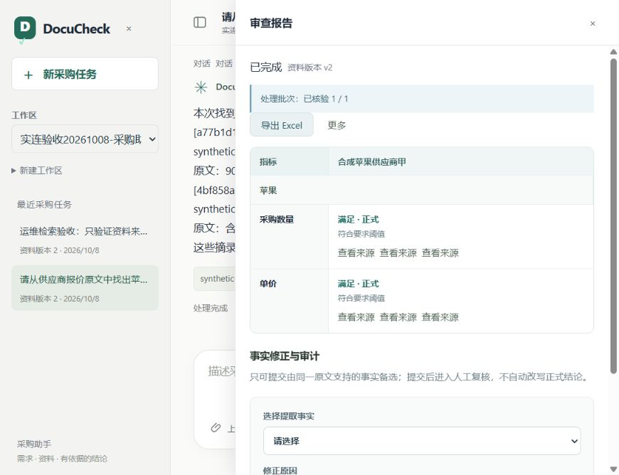
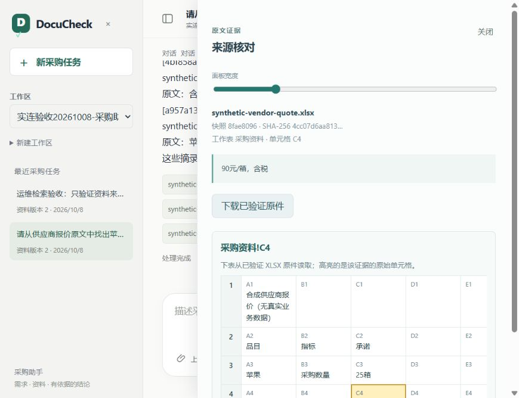

# DocuCheck · 多品类采购文档审查助手

2026-10-23已更新本机服务到2d0eb30，并在原苹果任务中一次找回最早原话与可读出处；141份后端源码/健康/鉴权核对，654份原件保留。新增2次真实模型请求、未知0，详见[本机实连记录](docs/first-task-message-2026-10-23.md#本机服务更新与指定问题实连)。前端样式未改，未合并主区或推送；下文为此前阶段。

2026-10-23最早原话定位补修：服务端在当前采购任务中跨对话/资料版本定位最早用户消息，直接显示原话与可读出处，用户无需提供内部ID；长原话分段，权限及截止守卫保留。独立复核及隔离MySQL三项通过，完整离线2475通过/62跳过、网络0，依赖与Ruff通过，见[本步记录](docs/first-task-message-2026-10-23.md)。本轮未部署/合并/推送，真实模型0次；下文为此前阶段。

2026-10-23历史回读补修：两类历史工具明确本对话当前快照/冻结交接范围；首次范围拒绝允许一次只读纠正，重复或再次拒绝停止，未核实原话时给中文说明。权限、版本和截止守卫保留，工具诊断无正文。后端2445通过/59跳过、网络0，独立复核无实证P1/P2；固定3fbf0f5已应用API/worker并核对健康、源码与数据。浏览器自动化连接超时，页面真实模型复测未完成，本步新增模型请求0，见[交付记录](docs/history-read-recovery-2026-10-23.md)。

2026-10-23真实验收：API/worker运行1328140，重问已返回20箱，摘要保存和用量显示通过；历史回读/跨对话回忆失败，正式审查及一次重试仍部分完成，重试保持审查意图，无context_budget。本次含原失败与诊断共16次真实请求、未知0；不能称全部上下文真实验收完成。离线门禁2431通过/59跳过、网络0，见[当前运行与剩余问题](docs/context-live-service-2026-10-23.md)。

2026-10-23本机已应用上下文改造固定版本b0923ec，页面为`http://127.0.0.1:15173/`；健康、运行源码及旧历史核验通过，登录后真实请求待试用，见[服务应用记录](docs/service-context-update-2026-10-23.md)。下文各阶段“未部署”指原交付时状态；主工作区未合并，真实模型本轮0次。

[](https://github.com/YanShui9/docucheck/actions/workflows/offline-ci.yml)


**把采购需求、报价表和供应商材料，整理成有原文依据、可人工复核的审查结果。**

DocuCheck 是一个以中文聊天为入口的个人开发项目。用户描述需求或上传 PDF / Excel，编辑并确认本次采购的审查清单，再上传供应商资料，进行资料问答、完整审查、事实复核与结果导出。

品目和指标按采购任务配置，支持数值、金额、枚举、资料存在、期限与人工核对六类规则。水果、服装和手机仅是合成示例；产品没有商品白名单。数量、单价、交期和规格的来源与口径不明确时，保留冲突、证据不足或待人工确认。

**当前为开发中的作品，已冻结新增业务功能。** 已有本地合成场景闭环与离线回归；指定手机审查、历史工具回读与一个 XLSX 混合检索尾部反例通过真实模型复测。补修多品目批次后，2026-10-17 一次新浏览器任务在 **392.719 秒**内完成上传、清单确认、范围关联、hybrid问答、四项正式审查、修正拒绝、原生下载与历史回放；中途恢复解析进程的耗时计入。该结果是一个已见合成场景的演练，整体多品类质量和生产条件尚未验收。没有公网试用站。

2026-10-21[清单与资料补修](docs/repair-remaining-chat-materials-2026-10-20.md)支持直接查询已确认规则、规则调整后安全续用资料对应，并区分历史读取失败与真实空资料。API与worker随后已更新到516023d，运行身份、健康、旧历史及脚本清单问答通过；本轮尚未调用真实模型，见[服务更新记录](docs/service-checklist-update-2026-10-21.md)。

同日完成[资料关联弹窗简化](docs/repair-binding-dialog-clarity-2026-10-21.md)：当前关联与待保存修改分开展示，编辑按需打开，旧关联和未知保存结果有明确提示。前端273项、类型与构建通过，完成桌面和窄屏合成预览；此次只修改前端，未更新后端运行版本。

**阅读入口：** [架构与设计取舍](docs/architecture-and-interview.md) · [评估结果与限制](docs/evaluation.md) · [安装与运行](docs/reproduction.md) · [十分钟演示指南](docs/interview-demo.md) · [文档导航](docs/README.md)

## 使用流程


以下截图来自 **2026-10-08 的本地浏览器验收**，使用合成苹果采购资料，展示当时的界面和历史结果。后续资料与品目对应的指定合成闭环见 [10 月 11 日验收](docs/document-item-binding-c-acceptance-2026-10-11.md)。

| 按指标查看审查结果 | 定位报价原文 |
| --- | --- |
|  |  |

## 三条核心链路

1. **资料问答：** 授权范围内的 BM25Plus 与 BGE-M3 / Milvus 检索，通过 RRF 融合候选，再回读数据库原文、重验版本与引用。检索不可用或范围分块不兼容时明确降级；top-k 未命中不用于证明资料缺项。
2. **正式审查：** 用户确认的动态清单与资料范围冻结为快照，LangGraph 工作流分批全量抽取事实，检查来源和覆盖，再用确定性规则判定。中断和 partial 保留未完成范围；人工复核修改有依据的事实，不能直接把结论改成“满足”。
3. **后台执行：** 同一 MySQL 事务保存消息、Run 和 Outbox，dispatcher 经 Redis / Celery 派发。worker 通过 attempt、fence 与版本检查领取和回写，拒绝过期执行结果，支持幂等提交、澄清和显式重试。

聊天入口使用应用自己的有界工具循环，正式动态审查使用 LangGraph；旧固定字段工作流保留用于兼容与回归。Redis 仅作为 Celery broker，业务状态保存在 MySQL，没有 Redis 业务缓存。恢复依赖应用数据库，未实现任意图节点续跑或外部模型请求恰好一次。

| 模块 | 技术与源码入口 |
| --- | --- |
| API、身份与权限 | FastAPI、Keycloak OIDC / PKCE；[API](backend/app/api/main.py)、[认证](backend/app/api/auth.py) |
| Agent 与模型适配 | LangChain、LangGraph、OpenAI-compatible Provider；[聊天助手](backend/app/agent/assistant.py)、[动态审查](backend/app/agent/dynamic.py)、[模型适配](backend/app/providers/chat_model.py) |
| 指标与事实判定 | Pydantic、Decimal、版本化规则；[指标契约](backend/app/criteria/models.py)、[事实与规则](backend/app/criteria/facts.py) |
| 检索与原文 | BM25Plus、Ollama BGE-M3、Milvus、RRF；[混合检索](backend/app/evidence/hybrid.py)、[授权检索](backend/app/db/persisted_retrieval.py) |
| 异步执行 | MySQL、SQLAlchemy、Alembic、Redis、Celery；[运行存储](backend/app/db/run_repository.py)、[Outbox 派发](backend/app/db/outbox_dispatcher.py) |
| 前端工作台 | Vue 3、TypeScript、Vite、PDF.js；[聊天工作区](frontend/src/components/ChatWorkspace.vue)、[审查报告](frontend/src/components/ReviewPanel.vue) |

原文保留 PDF 页码或 XLSX 工作表 / 单元格、文件哈希与解析版本。会话、清单、事实、报告和人工意见按版本保存；修改资料不会覆盖旧结论。上下文使用有界会话、任务状态和可回读的历史摘录，账号偏好须由用户明确保存。详细取舍见[架构说明](docs/architecture-and-interview.md)。

## 实测结果与已知限制

测试、服务验收和模型质量分别记录；下面的数量不相加，测试通过数不作为准确率。

| 范围 | 最近记录 | 如何理解 |
| --- | --- | --- |
| 源码离线验证 | 2026-10-23 上下文 C：后端隔离分支 **2426 passed / 59 skipped，网络尝试 0**，依赖与 Ruff 通过；前端 **302 项**、类型检查与构建通过 | 对应[C用量查看入口](docs/context-usage-C-2026-10-23.md)及[B2跨对话与版本交接](docs/task-handoff-B2-2026-10-22.md)、[B1语义摘要](docs/semantic-memory-B1-2026-10-22.md)、[A2b缩批与正式重试](docs/context-batching-A2b-2026-10-22.md)、[A2a容量与累计额度](docs/context-capacity-A2a-2026-10-21.md)。桌面/窄屏合成检查与独立复核通过；未合并/部署，外部集成跳过项不算实连通过；GitHub CI 状态见顶部徽章。 |
| 指定服务闭环 | 2026-10-16 应用 `2e862ac`：已见手机样例5份资料、8个位置均符合固定答案，17个证据组全部支持；同对话历史工具回读通过。两项使用5次模型调用 | [本轮实连记录](docs/evaluation.md#15-2026-10-16-当前版本的两项指定实连)、[机器摘要](evals/reports/candidate-live-2026-10-16.json)；单个已见样例，不是独立准确率或12包重测。此前[可靠性实连](docs/repair-consolidation-b-services-2026-10-13.md)分别保留。 |
| 多品类开发测量 | 2026-10-14：12 包、104 个判定位置；配置修正及显式恢复后 **6 包 completed / 6 包 partial，严格通过 3/12**；完整 Run 口径状态符合 **46/104**、必要证据 **39/82** | 作者已见的合成开发集，独立封存 **0**，保留未完成分母。质量出口未通过，后续修复未重测。[协议、失败与分母](docs/evaluation.md)、[机器摘要](evals/reports/dynamic-development-2026-10-14.json)。 |
| 检索对照 | 同一 PDF 语料 24 问，其中 20 问有答案；BM25 / 向量 / 混合 **Recall@5：85% / 92.5% / 82.5%** | 本轮混合未胜出；PDF-only 原文回读实验，不代表生产 PDF/XLSX 全链路或问答准确率。[评测边界](docs/evaluation.md)。 |

当前重点限制：

- **材料正文尚未可靠识别。** 新绑定 v12 对资料存在性规则的肯定事实暂保留“待人工确认”，即便带有材料来源组；这只是保守出口。明确未提供、资料冲突、缺证据与未完成覆盖继续分别处理，旧版本报告不重写。
- **质量与恢复仍需验收。** 正式抽取与来源关系的全量质量仍未达标；历史回读及[生产 XLSX 尾部反例](docs/evaluation.md#16-2026-10-16-生产混合检索尾部窗口实连)有指定实连证据。旧连续演练失败保留；[补修后的完整浏览器演练](docs/evaluation.md#20-2026-10-17-完整连续浏览器演练)已完成2/2批次、4条正式结果和十分钟内的完整操作。混合检索尚未证明优于单路；独立资料评估、维护者独立操作、完整费用核算及生产负载、监控与异机恢复仍未验收。
- **有明确容量与部署边界。** 清单最多 20 个品目、100 项指标；模型调用、上下文与耗时受预算限制。目前使用本地多身份演示拓扑，完整运行涉及多个服务。

2026-10-16 的[浏览器双品目主流程](docs/evaluation.md#17-2026-10-16-浏览器主流程与历史回放)及随后[单次连续演练的失败](docs/evaluation.md#18-2026-10-17-原生下载与单次连续演练)分别保留；旧失败包括服务中断、BM25降级和苹果批次未完成。批次补修后的[完整连续演练](docs/evaluation.md#20-2026-10-17-完整连续浏览器演练)已通过，未重试模型或覆盖旧Run。可下载同字节[合成报价](examples/showcase/synthetic-mixed-quote.xlsx)，按[演示指南](docs/interview-demo.md)复现；指定流程通过仍不代表多品类整体稳定性或生产可用性。

历史固定八字段版本的 104/104 仅留作已见开发验证，不作为当前多品类准确率。所有原始失败、显式重试、版本及数据限制见[评估说明](docs/evaluation.md)。当前按[收尾计划](docs/superpowers/plans/2026-10-13-project-consolidation.md)转向维护者独立操作、架构讲述和有限新资料验证；保持多品类范围。

## 快速验证：无需模型密钥或 Docker

Windows / PowerShell 示例；Linux 字体配置与完整服务启动见[复现手册](docs/reproduction.md)。建议先跑离线验证，再配置网页演示。

```powershell
git clone https://github.com/YanShui9/docucheck.git
Set-Location docucheck
conda create -n docucheck-repro python=3.12.14 pip -y
conda activate docucheck-repro
python.exe -m pip install --no-deps -r backend/requirements-dev.lock.txt
python.exe -m scripts.verify_offline --report data/verification/first-run.json
```

验证包含依赖检查、Ruff 与后端离线测试，测试阶段阻止意外访问真实服务。Windows 需要可用中文字体；报告文件名必须是新路径。完整后端验证可能需要十几分钟，每个子命令超时上限为 1200 秒。

前端使用 Node.js 24.14.1、npm 11.11.0 和依赖锁：

```powershell
Set-Location frontend
npm.cmd ci --ignore-scripts
npm.cmd test
npm.cmd run build
```

完整网页演示另需 MySQL、Redis、Keycloak、解析进程和 worker；语义检索需 Milvus 与 Ollama Embedding，模型调用需自行配置 Provider。启动 worker 可能产生实际调用与费用。仓库的离线测试不需要这些账号和服务。

## 仓库与开发说明

| 目录 | 内容 |
| --- | --- |
| `backend/app/`、`backend/tests/` | 业务代码、离线回归与显式启用的服务集成测试 |
| `frontend/` | 中文聊天、清单、报告与原文面板 |
| `evals/`、`examples/` | 合成资料、评估工具、评分协议与版本绑定的报告 |
| `deploy/`、`scripts/`、`ops/` | 本地部署辅助、验证入口与安全检查配置 |
| `docs/` | 架构、复现、评估和分阶段开发记录；从[文档导航](docs/README.md)开始阅读 |

项目开发使用 AI 辅助编码、测试和文档整理。[CLAUDE.md](CLAUDE.md)、[AGENTS.md](AGENTS.md) 与设计/验收记录保留协作约定和开发过程；AI 复审不算独立业务评估。代码、设计取舍、失败反例与验证边界均可按上述入口核对。

公开仓库包含源码、依赖锁、合成示例与可审阅报告；密钥、账号口令、数据库、用户上传原件、本地日志和运行产物不随仓库提供。部分历史报告引用的本地 `data/` 资产无法仅靠 Git 克隆取得，详见[安全与展示边界](SECURITY.md)及[复现手册](docs/reproduction.md)。

项目尚未指定开源许可证。问题反馈请使用 [GitHub Issues](https://github.com/YanShui9/docucheck/issues)，不要附带密钥或未脱敏采购文件。
