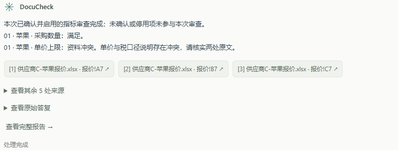
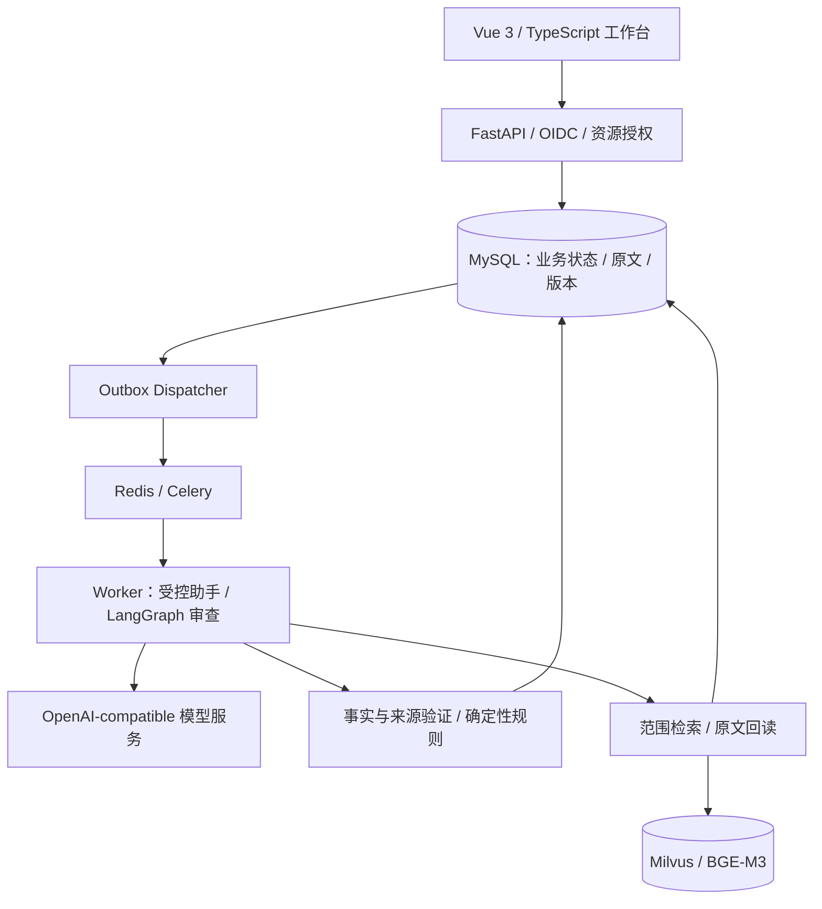

# DocuCheck · 采购文档审查 Agent

[](https://github.com/YanShui9/docucheck/actions/workflows/offline-ci.yml)


**从采购需求、供应商报价和证明材料，生成有原文依据、可人工复核的审查报告。**

DocuCheck 面向多品类采购的资料核对：用户用中文提出要求，确认审查清单并关联 PDF / Excel 资料，系统完成资料问答、事实抽取与规则判定，提供原文定位、人工复核、历史追溯和 Excel / JSON 导出。

例如“采购苹果 20 箱，每箱不含税单价不超过 25 元”：系统分别核对数量、金额、单位和税口径。即使报价数值为 25，若“不含税单价”与另一行“含税”相互冲突，报告仍保留为“资料冲突”，并提供两处原文。

[架构与设计取舍](docs/architecture-and-interview.md) · [演示指南](docs/interview-demo.md) · [安装与运行](docs/reproduction.md) · [验证记录](docs/evaluation.md) · [文档导航](docs/README.md)

## 从需求到报告


| 审查报告 | 原文溯源 |
| --- | --- |
|  |  |

截图来自 2026-10-08 的合成苹果报价验收，展示报告和来源面板。[双品目报告](docs/assets/candidate-mixed-review-2026-10-16.png)展示苹果、T恤分别满足与不满足的结果；可下载对应的[合成报价](examples/showcase/synthetic-mixed-quote.xlsx)，按[演示指南](docs/interview-demo.md)操作。



当前答复先呈现结论，来源用编号、文件名与原文位置查看；更多来源和原始答复可展开。图为已保存合成报价结果，见[展示验证](docs/answer-source-readability-2026-10-24.md)。

## 核心能力

| 能力 | 实现方式 |
| --- | --- |
| 动态审查清单 | 按采购任务配置品目与指标，支持数值、金额、枚举、资料存在、期限、人工核对六类规则；候选经过保存、明确确认后生效，最多 20 个品目、100 项指标。 |
| 资料问答与引用 | 在授权资料范围内进行 BM25Plus、BGE-M3 / Milvus 检索与 RRF 融合，回读原文并校验来源；引用可定位到 PDF 页码或 XLSX 单元格。 |
| 明确采购范围 | 明确 SKU 的任务可由用户核对并确认其他 SKU 的完整 PDF 页排除；范围版本、确认信息和全页原文随报告 / JSON / Excel 冻结追溯。 |
| 完整正式审查 | 冻结清单、资料版本及关联范围，分批覆盖供应商与指标；验证事实、来源和覆盖后，使用 Decimal 等确定性规则生成结论。 |
| 人工复核与追溯 | 区分满足、不满足、资料冲突、证据不足、待人工确认；事实修正须有原文支持，保留审计与历史版本，报告和导出读取同一份结果。 |
| 上下文与记忆 | 近期原话、滚动语义摘要、任务交接与历史回读分层使用；原始消息保留，旧回答与摘要不能直接成为采购证据。显示请求估算与实际 API 用量。 |
| 可靠后台执行 | MySQL 事务保存 Run 与 Outbox，经 Redis / Celery 派发；attempt / fence、幂等键与版本检查控制重复投递、取消和迟到回写。 |

## 架构与关键取舍



- **模型与规则分工。** 模型理解需求、选择受控工具并提出候选事实；应用校验权限、原文、单位、税口径和覆盖，明确阈值由规则比较。
- **问答与审查分工。** top-k 检索帮助回答问题；正式审查检查完整计划范围，未完成覆盖保留 partial，不能用检索未命中证明资料缺项。
- **状态由数据库管理。** MySQL 保存权威业务状态，Redis 用于队列投递；旧 attempt 无权覆盖新结果，未知模型响应单列记录。
- **上下文按请求装配。** 按模型配置预留输出和安全余量，必要时拆分完整审查请求；字节估算与真实 token 用量分别展示，不静默截断必要证据。

| 模块 | 技术与源码入口 |
| --- | --- |
| API 与身份 | FastAPI、Pydantic、Keycloak OIDC / PKCE；[API](backend/app/api/main.py)、[认证](backend/app/api/auth.py) |
| Agent 与模型适配 | LangChain、LangGraph；[聊天助手](backend/app/agent/assistant.py)、[审查工作流](backend/app/agent/dynamic.py)、[Provider](backend/app/providers/chat_model.py) |
| 规则与来源 | Decimal、版本化事实；[事实判定](backend/app/criteria/facts.py)、[金额与税来源](backend/app/criteria/money_sources.py) |
| 检索与索引 | BM25Plus、Ollama BGE-M3、Milvus、RRF；[混合检索](backend/app/evidence/hybrid.py)、[授权回读](backend/app/db/persisted_retrieval.py) |
| 数据与异步执行 | SQLAlchemy、Alembic、Celery；[运行存储](backend/app/db/run_repository.py)、[Outbox](backend/app/db/outbox_dispatcher.py) |
| 中文工作台 | Vue 3、TypeScript、Vite、PDF.js；[聊天](frontend/src/components/ChatWorkspace.vue)、[报告](frontend/src/components/ReviewPanel.vue) |

## 验证与案例

| 验证对象 | 结果 | 记录 |
| --- | --- | --- |
| 后端冻结源码，2026-10-27 | **2729 passed / 63 skipped**，网络尝试 0；依赖检查、Ruff 通过；隔离 MySQL 21 项 | [PDF 范围排除与验证](docs/pdf-page-exclusions-2026-10-27.md)，对应可执行源码 `f4506ed`；外部集成跳过项单列。 |
| PDF 整页范围排除，2026-10-27 | 前端 **352 项**、类型 / 构建与合成组件浏览器通过；原 d03 两页排除生效，但后台新审查因材料候选被拒仍为 **partial，0/8 正式** | [实现与指定复测](docs/pdf-page-exclusions-2026-10-27.md)；正式出口未过，受保护业务页面未重验，原 18 包评分保持。 |
| 答复与来源展示，2026-10-24 | **324 项测试**，类型检查与构建通过；桌面、窄屏、原文入口及刷新历史核对 | [展示交付](docs/answer-source-readability-2026-10-24.md)，前端 `e1fb25c`；CI 状态见顶部徽章。 |
| 18 包合成资料首轮复测，2026-10-24 | 旧组 7/12 完成、状态符合 44/104；新组 5/6 完成、16/24，严格整包分别 1/12、1/6 | [完整评分与问题定位](docs/current-quality-retest-2026-10-24.md)，两组合成资料分别报告，包含全部 partial 和观测器限制。 |
| 完整双品目浏览器流程，2026-10-17 | 新任务完成清单确认、资料关联、问答、2 批次 / 4 项正式结果、无依据修正拒绝、导出和刷新历史 | [连续浏览器演练](docs/evaluation.md#20-2026-10-17-完整连续浏览器演练)，包含一次解析进程恢复。 |
| 多份报价一致性，2026-10-25 | 两项指定后台复测均完成：同价判为满足，不同价保留人工确认。旧 partial 与未知历史根因保留 | [最新正式复测](docs/source-relationship-diagnostics-2026-10-25.md)、[规则与首次实连](docs/consistent-money-sources-2026-10-25.md)；原 d01 和原 18 包评分保持。 |
| 数量与税口径案例，2026-10-24 | 数量 20 箱为“满足”；单价 25 元存在税说明矛盾，判为“资料冲突”；来源、JSON、Excel 与刷新历史一致 | [数量条件与正式复审](docs/quantity-condition-live-2026-10-24.md)、[税口径处理](docs/money-tax-live-2026-10-24.md)。 |

上述业务案例使用已见合成资料，测试通过数与指定流程验收分别记录。独立多品类准确率、生产容量和异机灾备不在这些结果的证明范围内；完整测量、失败样例与版本边界见[评估说明](docs/evaluation.md)。资料存在性规则的肯定候选保留人工确认，复杂条件和不明确的来源适用关系也交由人工复核。

## 快速验证

离线测试无需模型密钥或 Docker。以下为 Windows / PowerShell；完整服务配置及 Linux 字体要求见[复现手册](docs/reproduction.md)。

```powershell
git clone https://github.com/YanShui9/docucheck.git
Set-Location docucheck
conda create -n docucheck-repro python=3.12.14 pip -y
conda activate docucheck-repro
python.exe -m pip install --no-deps -r backend/requirements-dev.lock.txt
python.exe -m scripts.verify_offline --report data/verification/first-run.json
```

前端使用 Node.js 24.14.1、npm 11.11.0 和依赖锁：

```powershell
Set-Location frontend
npm.cmd ci --ignore-scripts
npm.cmd test
npm.cmd run build
```

完整网页在本机运行，需配置 MySQL、Redis、Keycloak、解析进程、worker 和模型 Provider；向量检索另需 Milvus 与 Ollama。模型请求会产生实际费用。公开访问入口为本仓库的截图、合成资料和技术文档。

## 仓库导航

| 目录 | 内容 |
| --- | --- |
| [`backend/`](backend/) | API、Agent、规则、数据访问、迁移与测试 |
| [`frontend/`](frontend/) | 聊天、清单编辑、资料关联、来源面板与报告 |
| [`examples/showcase/`](examples/showcase/) | 可下载的合成采购资料与参考说明 |
| [`evals/`](evals/) | 评分协议、评估工具与版本绑定报告 |
| [`docs/`](docs/README.md) | 架构、演示、复现与技术记录 |
| [`scripts/`](scripts/)、[`deploy/`](deploy/)、[`ops/`](ops/) | 验证、部署和运行辅助 |

项目使用 AI 辅助编码、测试与文档整理，协作约定和设计记录保留在仓库中。密钥、数据库、账号口令、用户上传原件及本机运行日志不随仓库发布，详见[安全说明](SECURITY.md)。仓库尚未指定开源许可证；问题反馈可提交 [Issue](https://github.com/YanShui9/docucheck/issues)。
