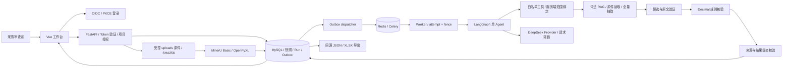

# 架构、Agent 设计与面试追问

日期：2026-10-03。这是当前实现的技术讲述及部署边界，源码指纹与实测数字见[M5-B 报告](m5-b-development-validation-2026-10-03.md)。

## 一分钟项目说明

DocuCheck 是笔记本采购资料初审 Agent。需求 PDF、供应商报价 XLSX、规格 PDF 先解析成带位置的版本化证据；用户提问后，LangGraph 单 Agent 调用白名单工具检索、读取、完整提取、规则核验及提交来源答复。MySQL 保存输入快照、Run/attempt、结果和修正审计，Outbox + Redis/Celery 负责异步执行，OIDC 和项目权限保护所有子资源。

## 真实的模块关系

API/解析进程当前在 Windows，队列与 Agent worker 在 Linux Docker；共享 data 目录映射至 worker `/data`。这是已运行的本机多人身份演示拓扑；生产形态需替换为受控共享/对象存储、托管数据库与企业身份服务，不能只扩大 localhost 监听地址。

## 为什么是 Agent，哪里有确定性工作流

LangGraph 管理决策/工具执行/结束节点；模型基于问题和当前状态选择可用工具。工具包括 list_case_sources、search_evidence、read_source、extract_facts、evaluate_checks、get_check_results、submit_answer、request_clarification。用户自由追问可以检索/读取，缺范围时可请求澄清。

完整八字段审查采用有边界的混合方式：模型识别任务、生成提取候选；服务端保证供应商×字段覆盖、安排提取/核验进度，全部规则结果齐备后受控提交。它不是无限自主循环，也不应宣传成任意任务的通用 Agent。模型不拥有跨 Case 查库、任意文件路径、网络浏览、SQL 写入或原件修改工具。

## 模型、思考与上下文

- LangChain ChatOpenAI 适配 OpenAI-compatible Provider，针对 DeepSeek 的请求字段作窄适配；响应经 JSON Schema 和工具参数验证。缺少配置失败，无假模型降级。DeepSeek 默认关闭 Provider thinking，`standard/thorough` 是应用审查预算和覆盖模式，不等于模型内部推理开关；没有存储或展示私有思维链。
- 当前快照的证据和服务端范围是上下文权威。会话记忆保留已验证结果句柄、事实缓存和用户追问所需摘要；历史自由文本不成为新事实，版本/供应商/字段范围改变时校验缓存适用性。
- prompt 包含当前问题、受控工具观察和必要原文，长工具结果分页/压缩；不把整份历史聊天无限堆入 100 万上下文。标准模式最多 16 次模型调用、8 次决策；thorough 最多 32 次模型调用、12 次决策；全 Run 默认 120 秒，单次请求最多 30 秒。调用、工具、输入/输出、prompt 容量共用预算，正式审查先做容量检查。
- token 上界估算与 Provider usage 分开记录；usage 丢失或中断记未知，不填零。SDK 与 LangChain 自动重试关闭；只允许有记录、共享预算内的有限结构纠错，结果未知的运输错误不自动再发。

## RAG、抽取与规则的分工

| 层 | 负责什么 | 不能推断什么 |
| --- | --- | --- |
| 词法检索 | 按 Case/快照/供应商约束，用 Jieba/BM25 和字段词映射找候选原文与邻近块。无需向外发送 embedding。 | top-k 没命中不证明缺项；固定字段 recall 不等于 Agent 自己选查询的 recall。 |
| 全量抽取 | 扫描所有适用文档并分批提取八字段，记录文档/字段覆盖和候选来源。 | 文档 partial、预算中断或抽取失败不能冒充“完整扫描后不存在”。 |
| 原文验证 | 数值/单位/限定词、证据角色、供应商/型号和关系；相邻单元格标签与数值一起核对。 | 模型“说来源支持”不等于支持；容量上限/可选配置不自动当已装配置。 |
| Decimal 规则 | 统一标称单位和明确阈值，输出满足/不满足/证据不足/待人工确认/资料冲突。 | 税前/含税、工作日/自然日、起算点或型号不明时不能强行比较。 |
| 答复提交 | 只引用当前范围内已验证结果和原件位置，强制完整任务覆盖。 | 模型自由文本不能覆盖正式规则结论。 |

同一供应商、型号、口径出现多个不同值即冲突，即使它们各自都达到最低阈值也保留冲突。交付期限核验供应商的**承诺上限**：同口径 21 天相对要求 20 天为不满足；不是猜它可能提前送达。

## 如何证明没有编造来源

文件落盘即记录 SHA-256，Document 绑定角色、supplier 和 model；解析输出 EvidenceBlock 带 PDF 页码/bbox 或 XLSX 工作表/单元格及原文。Run 绑定输入快照。工具参数不会获得替换 Case/snapshot 的权限，答复只接受已验证结果句柄和相应证据。历史修正复制生成新快照，原件、旧事实和旧结果保留。

资料正文中的“忽略系统指令”等是非可信内容，不能提升成 Agent 工具或系统指令。数据范围与权限由服务端检查；这是防御边界与测试覆盖，不承诺对所有新型 prompt injection 都已免疫。

## 异步任务为何没有重复写入

创建 Run 与 Outbox 在同一 MySQL 事务提交，发布 Redis 不占用该数据库事务。Celery 消息可能重复；worker 以 run_id、attempt_id 和递增 fence 领取/回写，过期 attempt 无权提交，取消/版本变更会使旧运行失效。dispatcher 可重派仍排队且范围有效的失投事件，租约到期可回收状态。

当前没有逐节点 LangGraph checkpoint 恢复。中断后的显式 retry/resume 受 Run 状态约束，创建新 attempt；适用快照中的已验证事实/结果可复用，不恢复私有思维链或假定中断请求没发生。

这提供任务状态和数据库提交的幂等边界，**外部模型请求没有恰好一次保证**：断网/崩溃后可能已计费但结果没有返回。当前取消会在下一次预算检查停止后续调用；已发请求不能撤回，运行中取消最坏需等待请求返回/超时。已测排队取消不能替代运行中取消延迟实测。

## 人工修正为何不能改成“采购人员希望的值”

修正 API 只接受同一原文支持的提取值与单位，记录理由/主体，产生新版本并先做规则重算。旧新值同源都有支持时保留冲突/needs_review。它纠正提取，不编辑采购原件，也不允许手动把不满足强改为满足。重算不调用模型；之后的新问答会读取适用的新版本事实。

## 面试追问的真实回答

| 问题 | 当前可以回答 |
| --- | --- |
| 为什么不用多 Agent？ | 任务边界明确，单 Agent + 受控工具便于证据/预算/取消统一校验；还没有分工复杂度和实测收益支持多 Agent。 |
| 为什么不用向量库？ | 当前是小型明确数值资料，词法映射可控且来源可测；未做向量检索对照实验，因此不声称 BM25 对所有资料更优。 |
| 为什么有 LangChain 又有 LangGraph？ | LangChain 提供模型/消息/工具契约；LangGraph 管状态与节点流转。快照、可靠执行与授权仍由应用/数据库实现。 |
| 你的准确率是多少？ | 同版本、12 包作者已见的合成开发集，104/104 状态、89/89 必要证据、危险满足 0。不是独立未知资料准确率。 |
| 延迟是多少？ | 固定五文件十任务，9 个成功且≤120秒，1 个驱动中断；成功任务 P50 53.453秒、P95 61.422秒。包含该协议的上传至结果过程，不把失败丢出原分母。 |
| 成本是多少？ | 记录请求/token 与公开价格参考；缓存计费拆分和实际账单未知，不能报一个虚假的精确费用。 |
| 上线是否企业级？ | 权限、状态机、来源、幂等、审计和离线 CI 有实现与测试；生产部署、独立资料、完整灾备/并发/监控/SLO 验收仍需完成。 |
| 失败如何解释？ | 历史 47/104、80/104 等失败与各版 source hash 保留；来源覆盖、提取进度、上下文和 schema 失败逐项修复后整轮复测，不只挑成功截图。 |

## 已测与仍需部署验证的边界

支持当前约定的 PDF/XLSX、最多三供应商八字段、单文件 10MiB 及受限工作表/行列/单元格；扫描图、绘图、隐藏内容、复杂表格或混型号可能 partial/拒绝，需要人工处理。上传允许的字节/页数不保证整次 Agent 容量够用。

还需要：真实独立资料/人工封存、实际账单和缓存分类、运行中取消时延、并发负载/资源配额、文件恶意内容隔离、生产身份配置、传输/存储加密、对象存储一致对账、日志告警与 SLO、数据库/身份/原件的异机恢复演练、迁移与发布回滚。M5-C 的干净环境回归和资料归档恢复不替代这些能力。
