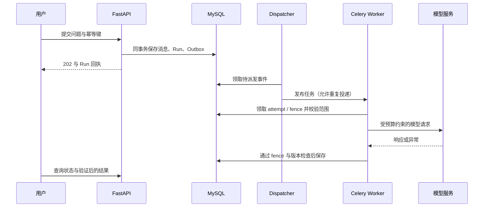

# 架构与设计取舍

更新日期：2026-10-15。本文介绍当前源码的设计；各功能是否已经应用到本地服务、经过真实模型验收，以[评估说明](evaluation.md)及阶段记录为准。当前已冻结新功能，修复后的源码门禁与未通过的业务质量出口分别记录在[收尾计划](superpowers/plans/2026-10-13-project-consolidation.md)，设计目标不等于全部故障边界已通过。

## 一分钟理解项目

DocuCheck 是中文采购文档审查助手。用户通过聊天或需求文件提出动态指标，保存并确认后，系统从供应商资料提取事实、验证原文，再用规则生成可复核结论。聊天、资料问答、清单候选和正式审查是不同操作；候选与普通聊天不会自动成为采购基准。

采用有边界的助手路由与单 Agent 审查工作流。模型负责理解和候选，应用负责身份、资料版本、覆盖、预算和正式提交。MySQL 保留业务真值，Milvus 提供受限的向量候选，异步队列执行耗时工作。

## 1. 聊天与正式审查怎样衔接

1. FastAPI 验证登录令牌和项目权限，创建消息、Run 与 Outbox。模型不能通过参数指定另一个身份、Case 或资料快照。
2. dispatcher 发布队列任务；worker 用 attempt 和 fence 领取，读取该 Run 冻结的上下文与版本。
3. `assistant.py` 在预算内选择普通聊天、资料问答、清单变更或正式审查。修改清单先准备目标，只在编辑阶段加载完整 patch schema。
4. 资料问答先检索，再读取并验证直接相关的原句；正式审查进入 `dynamic.py` 的 LangGraph 流程，处理全部计划中的供应商×指标。
5. 模型输出经契约和来源验证。规则判定保存在数据库，前端与 JSON / Excel 使用同源结果。

LangChain 提供模型、消息与工具契约，LangGraph 管理审查状态流转。普通助手路由还有应用自己的受控循环；没有把所有功能都交给一个无限自主执行的图。

## 2. 动态指标怎样保持可控

品类和指标名由每次采购决定。规则限定为数值、金额、枚举、资料存在、期限和人工核对六类，而不是执行模型生成的 Python / SQL。

每项指标绑定稳定 `criterion_id` 和 `item_id`、来源、单位及条件。明确规则走确定性比较；没有具体要求、复合条件或口径不一致时保留人工核对。模型提出的候选要经过用户保存草稿和明确确认两步，确认版本不可变。

结果有满足、不满足、资料冲突、证据不足、待人工确认五类；partial 是执行覆盖状态，不是第六类业务结论。新绑定 v12 对资料存在性规则的肯定候选暂保留待人工确认，即便附有材料来源组，因为当前尚无独立验证的正文识别能力。明确未提供、冲突和缺事实仍区分处理；旧版本规则与报告保留，不能把临时人工出口算作自动审查质量已达标。

修改资料会产生新快照。旧要求、旧结果仍可追溯，不能悄悄成为新版本正式结论。人工修正纠正提取事实，必须有原文支持；不是修改需求文件或直接编辑结论。

## 3. RAG 与完整审查为什么分开

| 路径 | 工作方式 | 覆盖约束 |
| --- | --- | --- |
| 资料问答 | BM25Plus 与本机 BGE-M3 / Milvus 各召回候选，RRF 融合，回读 SQL 原文 | top-k 仅是线索，无命中不能证明资料缺项 |
| 正式审查 | 按适用资料范围分批全量抽取，验证候选事实与覆盖，再运行规则 | partial、失败和预算中断都不能冒充“完整扫描后不存在” |

原件落盘记录 SHA-256；解析证据保留 PDF 页码或 XLSX 工作表 / 单元格。分块映射到原文字符范围。Milvus 保存向量和 locator，SQL 保存原文、授权与有效索引清单；检索结果须重验 ID、指纹和权限。

索引任务有 generation、租约和 ready manifest。SQL 与 Milvus 没有跨库事务，采用版本过滤、写后回读、就绪提交和可重试删除对账。服务不可用时明确降级为词法检索，不伪装成成功的语义检索。

最新品目对应后端将整份文件、XLSX 区域或 PDF 页范围冻结到 Run。只有完全位于允许范围的既有 chunk 进入向量候选；粗块跨范围、过滤超过预算时使用范围内词法检索。普通授权浏览首轮仍可不选择品目，不能声称服务端已经自动完成全部品目识别。

## 4. 上下文与记忆设计

| 层次 | 存储与使用 | 可信边界 |
| --- | --- | --- |
| 原始会话 | MySQL 保存真实消息与不可变答复阶段 | 裁剪模型窗口不删除原消息 |
| 近期上下文 | 有界完整问答对，按剩余预算选择 | 不无限堆叠聊天记录 |
| 较旧摘录 | 确定性结构摘录，保留消息 / 阶段来源，必要时分页回读 | 不是模型生成的语义长期记忆，也不成为采购证据 |
| 任务状态 | 焦点、待澄清和已验证事实 / 结果句柄，绑定任务、快照与来源 Run | 跨版本、失权或来源无效时拒绝复用 |
| 账号偏好 | 用户明确保存的语言、长度和格式，可删除及到期 | 不能写入采购阈值、供应商事实或任意系统提示词 |

完整清单保留在服务端。模型先读取有限目录，编辑时只装配目标指标与必要工具；未修改项由服务端合并保留。工具观察分页和替换，按阶段审计输入上界及省略内容。纯日期问题按需读取宿主时间，不在每轮注入日期。

输入上界估算与 Provider 的真实 token usage 分开。必要问题、单位和条件不能为适配预算而静默截掉；必要内容仍放不下时明确停止或请求缩小范围。

## 5. 异步执行与失败恢复

Redis 不是任务状态真值。重复投递可以发生，但过期 attempt 无权回写；取消、资料变化和权限撤销会阻止迟到结果提交。澄清释放 worker，用户回复后受控恢复；中断通过显式重试产生新 attempt。

当前没有 LangGraph 官方 checkpointer 的任意节点续跑，也没有保证外部模型请求恰好一次。运输故障可能已经计费但结果未返回，处理原则是记为未知、不填零或盲目自动重发。收尾 F4 已补运行中取消保守记为未知的行为，并通过隔离 MySQL 终态与迟到提交验收；聊天和动态路径收到确定内部响应后可补真实用量，旧固定字段路径继续保守留未知。已经发出的模型请求无法撤回。这些门禁不替代生产负载与全故障恢复验收。Redis 在本项目用于 Celery broker，没有实现业务缓存或语义缓存。

## 6. 技术栈与工程入口

| 层次 | 技术 | 建议阅读的源码 |
| --- | --- | --- |
| API / 身份 | Python 3.12、FastAPI、Keycloak OIDC / PKCE | [API 入口](../backend/app/api/main.py)、[认证](../backend/app/api/auth.py) |
| Agent / 模型 | LangChain、LangGraph、OpenAI-compatible Provider | [助手](../backend/app/agent/assistant.py)、[动态工作流](../backend/app/agent/dynamic.py)、[模型适配](../backend/app/providers/chat_model.py) |
| 动态业务契约 | Pydantic、Decimal、确定性规则 | [指标](../backend/app/criteria/models.py)、[事实与核验](../backend/app/criteria/facts.py) |
| 数据与任务 | MySQL、SQLAlchemy、Alembic、Redis、Celery | [运行存储](../backend/app/db/run_repository.py)、[Outbox](../backend/app/db/outbox_dispatcher.py) |
| RAG / 索引 | BM25Plus、Ollama BGE-M3、Milvus、RRF | [融合检索](../backend/app/evidence/hybrid.py)、[持久化检索](../backend/app/db/persisted_retrieval.py) |
| 上下文 / 记忆 | 有界视图、版本化任务状态、SQL 摘录与偏好 | [助手上下文](../backend/app/agent/assistant_context.py)、[记忆存储](../backend/app/db/memory_repository.py) |
| 前端 | Vue 3、TypeScript、Vite、PDF.js、Vitest | [聊天工作区](../frontend/src/components/ChatWorkspace.vue)、[报告](../frontend/src/components/ReviewPanel.vue) |

模型配置可替换，但工具调用与结构化输出契约须重新验证。演示使用过 DeepSeek；`standard/thorough` 是应用预算和审查模式，不等同于模型内部思考开关，系统不记录或展示私有思维链。

## 7. 可以进一步追问的设计取舍

| 问题 | 当前回答与可检查的依据 |
| --- | --- |
| 为什么选择单 Agent？ | 资料核验需要统一来源、权限与预算；目前没有实测收益证明要增加多 Agent 协作复杂度。 |
| 为什么同时用规则和模型？ | 模型处理自然语言与候选，明确阈值由规则比较；口径不明保留人工核对。[事实规则](../backend/app/criteria/facts.py)可复核。 |
| 为什么不把聊天全部放入上下文？ | 历史、完整清单和工具 schema 的固定开销会挤占预算；按阶段选择视图、保留服务端权威对象。[上下文回归](../backend/tests/test_assistant_stages.py)覆盖长清单与后置目标。 |
| Milvus 命中就可信了吗？ | 候选还需 SQL ready 清单、版本、指纹及原文重验；网络等待之后重新检查权限。[范围检索回归](../backend/tests/test_item_binding_retrieval.py)覆盖越界与降级。 |
| 你的准确率是多少？ | 尚无可信的独立泛化准确率。10 月 14 日多品类已见开发测量为 12 包、严格通过 3/12、完整 Run 口径状态符合 46/104、必要证据 39/82；保留 6 个 partial，后续源码修复未复测。独立封存为 0；历史固定字段 104/104 不替代当前结果。见[评估](evaluation.md)。 |
| 混合检索一定更好吗？ | 本轮 PDF-only 对照的 20 个有答案问题中，BM25 / 向量 / 混合 Recall@5 为 85% / 92.5% / 82.5%，混合未胜出；须检查排序和生产分块，不能仅凭用了 RRF 就宣称优化有效。另有 4 个无答案问题单列，不混入 Recall 分母。 |
| 当前能否直接生产上线？ | 有权限、版本、幂等、审计和 CI 的实现与验证；生产容量、独立质量、监控和异机灾备仍需验收。 |

当前已验证成果和未完成项分别见[评估说明](evaluation.md)与[路线图](development-roadmap.md)。
