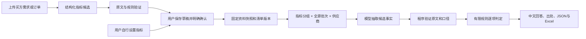

# 动态清单 B：候选、核验与运行记录

本轮完成动态清单的后端主流程。指标取自每次采购的确认清单，用户和品类均没有白名单；水果、服装、电子产品只是回归示例。前端和旧 API/Celery 进程未同步重启，另一个 AI 负责的 Ollama/Milvus 实连任务未被操作。

## 1. 实际代码与流程

| 模块 | 实现 |
|---|---|
| `criteria/models.py` / `validation.py` | 区分用户设定和文档提取；候选原文、比较符、阈值、单位、品目与有限语法验证 |
| `criteria/facts.py` | 数值/金额/枚举/资料声明/期限/人工项；Decimal 比较；同源及跨源冲突、品目与型号关联 |
| `agent/dynamic.py` | LangGraph 受控工具决策；候选、全矩阵审查、来源追问、历史读取、预算和一次协议修复 |
| `db/dynamic_executor.py` | 复用队列、attempt/fence、权限、心跳、取消、近期上下文与分层记忆 |
| `db/dynamic_repository.py` | 清单版本绑定、持久批次、读回重验、人工备选事实审计、来源/版本失效处理 |
| `0015_dynamic_agent.py` | 三个附属表，不改变原八字段结果的含义 |
| `api/dynamic_schemas.py` / `api/run_export.py` | 修正候选契约、中文导出与原文一致性；旧 JSON 保持原有字段结构 |

候选生成不会自动修改或确认买方要求。已确认清单存在时，普通审查消息进入动态执行器；未确认草稿阻止审查。显式旧运行及旧八字段报告继续保持兼容保护。

## 2. API 顺序

先上传并解析资料，再创建会话：

1. `POST /api/v1/conversations/{id}/messages`：`operation="propose_checklist"`，携带当前 `expected_revision` 和 `Idempotency-Key`。买方资料必须以 `requirement` 角色上传；文件类型不会自行赋予买方权限。
2. `GET /api/v1/agent-runs/{run_id}/proposal`：读取候选定义、问题、资料与清单修订号。候选只作为预览。
3. `PUT .../snapshots/{snapshot_id}/checklist`：用户核对、修改、保存草稿；再 `POST .../checklist/confirm`，明确 `confirmed=true` 和选定指标。
4. 再发 `operation="review"`（默认）：固定确认版本，全量审查全部供应商与启用指标。纯手工清单无需额外买方文件，实际引用的资料仍必须有效。
5. 读取 `/checks`、`/facts`、`/progress` 和 `/export?format=json|xlsx`。正式标记同时要求当前资料/清单、完成状态和完整处理；历史/部分/人工修正待复核不会被提升为正式结论。

人工事实复核使用 `POST /agent-runs/{id}/fact-corrections`，提供旧 `fact_id`、同范围 `FactCandidate`、原因、资料修订号和 `/facts` 返回的 `payload_digest`。只能增加同一原文支持的备选事实，不覆盖采购要求或原文；原文支持两值时保留冲突和旧/新载荷审计，后续完整复审仍保留人工复核状态。`GET .../fact-corrections` 可查记录。

自然语言“把预算改成某值”的候选变更路由及聊天入口仍待 C/后续界面接入；目前用户修改要求通过已有草稿 API。普通聊天意图路由也仍未接入。本轮没有把 `propose_checklist` 当成通用聊天工具。

## 3. 约束与恢复

- 文档、模型、历史消息和个人偏好均不能改变 actor、资料范围、规则或授权。模型只提出候选，不执行表达式或任意代码。
- 文档型要求保留完整引用块和结构换行；拼接仅支持同文档同表同一行的连续单元格。手工要求的可选背景原文可引用子串，但角色/快照仍验证。
- 单品目也需品目或明确型号关联；梨的资料不能自动满足苹果的指标。缺少关联、可选/拟提供/复杂条件、歧义单位及不同计价口径保留人工确认。
- 周、年和伪单位不会被当成自然日/月；不同起算事件或工作日/自然日不混算。容量的十进制与二进制口径不混算。
- presence 仅核验原文对材料提供/缺失的声明，不能鉴定证照真实性；真实性、自由文本和未支持的要求进入人工项。
- 完整核验使用全量来源，不能用向量 top-k 代替覆盖证明。动态聊天的语义检索路由仍待后续整合；已有混合检索模块及另一 AI 的实连结果按其报告理解。
- 批次输入绑定快照、完整来源指纹、清单定义、规则、供应商、指标组和源序号。完成批次的每个有效事实必须出现在报告；批次缺失或篡改拒绝读取/导出。
- 重试复用同 Run 有效批次；同会话来源追问可复用原文重验后的报告，不跨会话恢复事实。清单或资料变化阻断旧尝试，历史报告按原确认版本读取。
- 新任务 checkpoint 为版本 4，保存来源 Run、快照、清单版本和载荷指纹。SQL 保存业务批次与应用任务记忆，**尚不是 LangGraph 官方数据库 checkpointer**。
- 资源保护仍为 20 品目/100 指标，标准最多 16 次、完整模式最多 32 次模型请求。40 指标×2供应商的离线脚本验证了 80 格完整枚举；没有以此宣称 100 指标的真实模型性能已验收。超预算输出 partial，可按原版本重试。

## 4. 审查与验证

独立只读审查发现并修复：期限单位误判、单品目串商品、人工备选复审丢失、手工清单强制需求文件、MySQL RR 新确认版本不可见、取消收尾已知用量丢失、完成缓存事实遗漏、导出来源变化及变化后恢复窗口。对应回归包含真实业务路径与 SQL 故障注入。

初次全量记录 `data/verification/dynamic-checklists-b-2026-10-04.json` 保留了 6 个旧接口形状失败；修复空动态字段的输出兼容后，`dynamic-checklists-b-final-2026-10-04.json` 为 **1115 passed / 35 skipped，网络尝试 0**。补齐回答中的文件名、页码/单元格及原句，并为同名指标显示品目后，最终交付记录 `data/verification/dynamic-checklists-b-delivery-2026-10-04.json` 为 **1123 passed / 35 skipped，网络尝试 0**，Ruff 与依赖检查通过。35 个跳过项为需显式开启的 MySQL、Docker worker、Milvus 等服务验收，不能算作已通过。

最后的动态业务、Agent、探针和旧导出定向回归 **82 passed**。独立只读复审确认导出来源变化后恢复、取消收尾 CAS 两项反例消除（定向 **5 passed**），本次范围没有新增 P1/P2；这不代表所有生产风险已经消除。

真实 MySQL：动态绑定/批次重试/fence/冲突写入/旧读视图并发确认、A 清单及既有 Run races 共 **11 passed**。迁移实际 head 为 `0015_dynamic_agent`，测试 outbox 隔离并清理测试 Case；未启动新 Docker 服务。

DeepSeek：本轮只发送合成苹果数量原文。首次候选把比较词写进名称，已做有限尾词规范化，原句和规则保持不变；规范化后候选、显式预设要求的审查及原文出处回答均 completed。本轮 **8 次真实请求，输入 12677、输出 700 tokens**，请求上限每探针 6 次；实际账单金额未知。记录分别为 `dynamic-provider-proposal-2026-10-04.json`、`dynamic-provider-proposal-normalized-2026-10-04.json`、`dynamic-provider-review-2026-10-04.json`、`dynamic-provider-citations-2026-10-04.json`。它们不替代 C 的多品类模型质量验收，也没有确认用户的业务清单。

## 5. 后续仍按原三个大步骤

C 做多品类/多品目/变更候选与接口验收，复核必要来源及旧八字段兼容，再准备聊天前端交接。前端规范、样式及真实运行服务同步按用户约定先讨论和告知。本轮未提交 Git；历史验收和旧进程不会因为源码更新自动变成新版成绩。

设计参考：[LangChain structured output](https://docs.langchain.com/oss/python/langchain/structured-output) 的响应校验与错误处理；[LangGraph persistence](https://docs.langchain.com/oss/python/langgraph/persistence) 的 checkpointer 与跨会话 store 区分。项目沿用现有 Provider 与受控图，应用持久化按真实实现说明。
