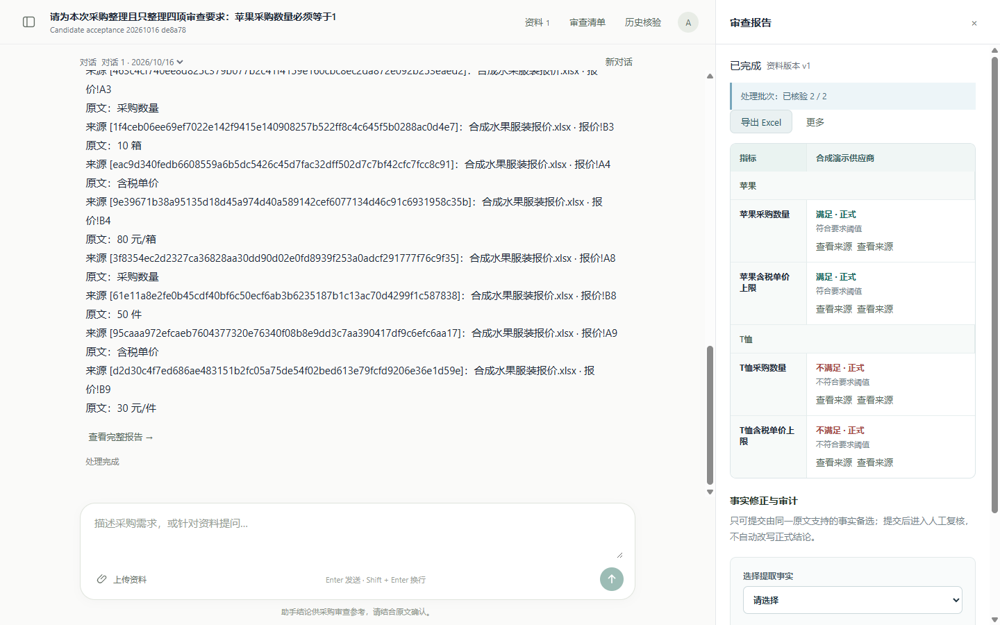

# 十分钟演示：从采购需求到原文复核

更新日期：2026-10-24。本页提供从采购需求到原文复核的十分钟讲述与操作顺序。完整双品目流程于[10 月 17 日连续浏览器演练](evaluation.md#20-2026-10-17-完整连续浏览器演练)完成；最新数量、金额与税口径案例见[10 月 24 日正式复审](quantity-condition-live-2026-10-24.md)。这些是指定合成资料的运行记录，现场操作与历史回放分别说明。

最近记录的本机 API、worker 与前端固定于 `e5da3d2`，部署、健康、源码身份及数据保留见[运行记录](money-tax-live-2026-10-24.md)。本页双品目步骤的原验收使用 worker `129cbbe`、迁移0018；历史结果保留其原版本，不能改称当前版本整轮重测。

项目面向多品类采购。本页使用苹果/T恤混合报价复现一次操作，并以旧手机报告展示历史与人工确认；样例可替换，不构成商品白名单。公开的[双品目报价](../examples/showcase/synthetic-mixed-quote.xlsx)与本轮上传原件字节一致，原文及SHA-256见[样例说明](../examples/showcase/README.md)。这些资料均为作者已见合成数据，不是独立评测集。

## 选择展示方式

| 形式 | 准备 | 展示内容 |
| --- | --- | --- |
| 源码与离线验证 | 克隆仓库、安装锁定依赖 | 契约、来源、权限、状态机、异常分支与构建 |
| 历史运行回放 | 本机已有记录，或查看公开报告与截图 | 对应版本的真实测量；说明这是回放 |
| 现场网页演示 | OIDC、API、解析、worker、前端；语义检索另需 Milvus / Ollama | 新任务实际调用模型、保存清单、问答与报告；可能失败和计费 |

当前没有公网演示站。公共访客可以从 README、截图和源码开始，完整现场演示由维护者在本机进行。

## 演示前准备

- 检查登录、数据库迁移、解析进程、后台 worker 与模型配置。品目对应前端和指定合成应用闭环已有[10 月 11 日验收](document-item-binding-c-acceptance-2026-10-11.md)，现场仍须核对加载的服务版本；历史通过不等于本轮重演完成。
- 使用[公开双品目报价](../examples/showcase/synthetic-mixed-quote.xlsx)，可直接下载，不依赖本机私有`data/`。公开单苹果报价对应首页2026-10-08截图，与10月24日税冲突案例是不同资料。
- 模型问答会发送问题和必要原文到配置的服务；演示者确认使用合成资料并接受调用费用。账号和密钥只在本机配置。
- 新建采购任务，保留 Run、资料版本、状态、调用与异常；模型异常不通过重复重试挑一个成功结果来隐藏。
- 演示前确认Docker、MySQL、Redis、Keycloak、Milvus、四后台角色、API、前端和Ollama均可用，并在上传前确认Embedding。页面“解析完成”不等于向量索引ready；若问答提示BM25降级，说明降级原因或切到历史回放。新机器按[复现手册](reproduction.md)配置；本机既有入口按最新运行记录核对。

以下时间段是讲述目标。已有一次自动操作在十分钟内完成的证据，计时从已登录并选好工作区开始，包含本轮操作和解析恢复；不把它当作人工操作速度、每次成功保证或服务性能指标。

## 0:00–1:00：业务与范围

说明场景：“买方提出要求，供应商给出报价和承诺。系统把动态指标与原文对应起来，展示哪些满足、哪些冲突、哪些还需要人工确认。”

指标随任务变化；固定设备八字段仅用于早期回归样例。系统不代替人工采购决策，也不自动确认买方要求。

## 1:00–3:00：上传资料、整理需求并确认

新建采购任务，上传`synthetic-mixed-quote.xlsx`，选择“供应商报价”，填写合法供应商编号（如`demo-vendor`）和“合成演示供应商”，等待解析完成。窄窗口中需要滚动资料面板，确保上传按钮可见。

输入：`请为本次采购整理且只整理四项审查要求：苹果采购数量必须等于10箱，含税单价最多100元/箱；T恤采购数量必须等于20件，含税单价最多25元/件。请生成两个品目各两项的候选清单，不增加交期或其他指标。`

点击“查看与编辑”，核对两个品目、四项规则和单位，先保存草稿，再点击“确认审查指标→确认生效”。本轮确认前按钮不能直接执行确认，保存后才可确认，模型生成、保存和生效三个状态分别展示。

## 3:00–5:00：上传资料与原文问答

在资料面板点击“关联采购品目”，选择表格范围。苹果使用`报价!A1:B5`，依据为`B2`的“苹果”；T恤使用`报价!A7:B10`，依据为`B7`的“T恤”。逐项加入待确认清单，核对后勾选并保存对应关系。混合报价不能选择“整份文件为单一品目”。

本样例旧产品标识未填写，范围按品目名称核对，不把品目名称当供应商SKU。新资料或清单升版后，按实际提示重新确认，不能沿用过期对应关系。

问：`请检索合成演示供应商报价中的苹果采购数量和含税单价，引用原文，不做完整审查。`

最新完整演练返回`报价!B3`的10箱和`B4`的80元/箱，实际item_id为apple、hybrid无降级，保存窗口全部在确认范围内。第18节旧演练曾因Ollama退出而明确降级BM25，该Run保留原状。点击单价来源，核对同排`A4`的“含税单价”和`B4`的数值。完整原件邻域可展示其他行，不能把邻域显示当成本轮检索扩大了证据范围。

## 5:00–7:00：正式审查与报告

在确认版本有效、资料完成的前提下，发起：`请按已确认清单完整审查合成演示供应商的两个品目和全部指标，列出结果与来源。`

最新完整演练完成2/2未缓存批次、四项正式：苹果10=10、80≤100满足；T恤50≠20、30>25不满足。第18节旧演练仅完成1/2批次、整份Run为partial且四项均非正式，失败记录保留。若现场再次发生未完成，展示`coverage_incomplete`、历史成功回放和服务端拒绝无效事实的边界；不要点击重试挑选一个成功结果。

区分处理状态与业务状态：completed 可以包含不满足、冲突或人工确认；partial 不能冒充完整扫描后的证据不足。

最新显式品目对应前端与指定合成闭环已交付；混合采购样例用对应范围展示不同品目的隔离，绑定使用实际原文范围。普通授权浏览不选择品目时，不能声称自然语言已自动提供硬隔离。

## 7:00–9:00：人工复核、历史与导出

选择苹果采购数量，尝试把10箱修为9999箱并说明这是无原文支持的反例。本轮实际拒绝，事实、结论及审计均未改变；点击“重试读取”可恢复报告。正确事实不必改成错误值，合法修正须有同一原文支持并保留审计。

点击“导出Excel”，或“更多→导出报告JSON”，核对四项状态、正式标记和来源。最新完整演练由Codex内置Chromium原生下载本轮completed报告的Excel、JSON与引用原件，均落盘并核对；第18节旧partial报告及早先agent-browser CLI取消记录另行保留。导出成功不能掩盖Run本身的partial状态。

刷新页面、重新选择演示工作区，打开“历史核验”：本轮候选、问答、正式审查三条记录均可重新读取。已有手机历史报告可另作回放，9项人工确认仍显示“历史结果/非正式”；明确说明这是旧运行，不能称本轮新v12材料正文识别通过。全新克隆没有开发机历史记录，可用公开评估记录解释此分支，不伪造旧任务。

## 9:00–10:00：解释架构与证据

展示[架构说明](architecture-and-interview.md)中的模型 / 规则分工、混合检索、分阶段上下文、Outbox 和 fence。

打开[评估说明](evaluation.md)：离线回归、指定实连与开发集质量分别报告。最近冻结源码为后端2588通过/62跳过、前端302项；旧104/104不是当前准确率，独立封存为0。10月17日演练的累计134次保持为历史账本，后续请求单列，实际费用以账单为准。第17至20节保留成功、失败及补修过程，10月24日案例另见[数量正式复审](quantity-condition-live-2026-10-24.md)。

若模型不可用，明确切换到公开截图、已有结果和源码回放；失败本身可以展示错误码、状态、来源保护和显式重试边界。
