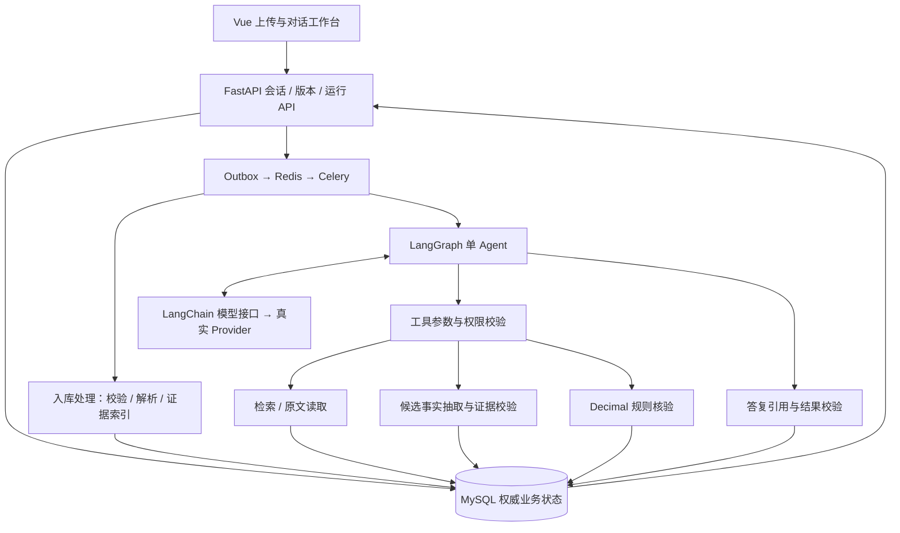
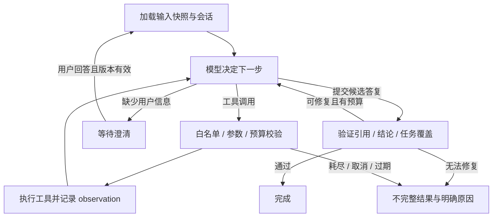

# DocuCheck Agent 架构 v1.0

日期：2026-09-24。状态：本次重新设计的实施基线，功能尚未实现。

本文取代同日 `single-agent-review-design` 和 `agent-context-and-rag-design` 两份 v0.1 设计。用户最新要求是以 Agent 为项目中心，上传后通过提问驱动工作；原交接文档中的范围、证据要求和质量门槛继续保留，原固定工作流顺序由本文调整。实施顺序以 [路线图](../../development-roadmap.md) 为准。

## 1. 产品目标与架构选择

用户上传采购需求、报价和规格书，向 Agent 提问。Agent 理解任务，决定查看哪些资料、使用哪些工具，根据工具返回继续取证、核验或请求澄清，最终给出可追溯的回答。支持证据问答、指定字段比较、完整八字段审查、结果解释和连续追问。

首版仍为本地单用户、笔记本采购场景：1 份需求，1～3 家供应商各 1 份报价和 1 份规格书，最多 7 文件；文本 PDF 和普通 XLSX；八字段为内存、存储、屏幕、重量、质保、数量、单价、交期。型号用于关联材料。扫描 PDF、多型号混合、外部采购系统和自动采购不在首版范围。

| 备选 | 优点与代价 | 决定 |
| --- | --- | --- |
| 单 Agent + 类型化工具 + 规则服务 | 可按问题动态行动，职责和故障路径可检查 | 采用 |
| 固定链式 RAG 问答 | 实现较少，但难以根据缺失证据继续查证或完成全面审查 | 可作为检索对照基线 |
| 多 Agent 分工 | 可分拆更复杂角色，但增加通信、状态一致性和成本问题 | 首版不采用 |

这里的工程规范包括：明确目标和工具权限、类型化状态、上下文隔离、证据可追溯、资源预算、人工介入、故障恢复和端到端评测。不存在本项目声称获得认证的统一“Agent 标准”。LangGraph 官方区分固定流程与由模型动态决定过程和工具使用的 Agent；本文采用后者的控制循环。[官方说明](https://docs.langchain.com/oss/python/langgraph/workflows-agents)

## 2. 用户体验与业务边界

1. 用户创建 Case、指定文件角色和供应商，上传文件；系统完成安全校验、解析和检索索引准备，展示覆盖情况。
2. 用户可以在解析期间提问；依赖未就绪时保留问题并显示等待，解析失败则明确受影响范围。
3. “供应商 A 的内存是否达标？”触发 Agent 检索需求及 A 的两份材料、读取原文、抽取候选事实、调用核验工具。发现两份材料数值不一致时展示双方来源。
4. “重量呢？”继承当前供应商和比较意图，重新检索重量证据；不把上一轮生成的自然语言当作事实。
5. “完整审查全部供应商”触发覆盖全部供应商和八字段的审查任务；逐项展示完成情况。工具内部可以批处理抽取，调度与是否继续仍由 Agent 决策，完整性由服务端校验。
6. “这里的工作日是什么意思？”可解释证据与比较限制；需要用户确认口径时进入澄清状态。修正事实要有原文、理由与明确提交动作，形成新版本并重算。

Agent 自主选择读证据和计算工具；只能提出修正建议，不能替用户改文件角色、覆盖历史事实、批准供应商或执行采购。对本地资料无关的问题说明能力范围。文档中的命令式文字只作为资料内容。

## 3. 系统分层

- LangGraph `StateGraph` 显式管理状态、循环、分支和终止；LangChain 的模型接口、消息与工具 schema 负责模型接入。首版不同时叠加另一套 Agent 执行器。
- 单个模块化后端有 API 和 Linux worker 两个入口。Conda 管理 Windows Python 3.12；Docker 承载 MySQL 8.4、Redis broker、Celery worker；MinerU/openpyxl 保留。
- 检索、抽取和规则是 Agent 可调用的能力。模型抽取工具中的模型请求也计入同一次运行的预算，不构成另一个 Agent。
- MySQL 保存原件版本、证据、事实、对话、工具事件、结果与 Outbox；Redis 不承担唯一记忆或报告存储。

## 4. Agent 状态与决策图

服务端创建只读 `RunContext`：`case_id, conversation_id, run_id, attempt_id, input_revision, snapshot_id, allowed_document_versions, model_config_version, prompt_version, rule_version, budgets`。模型不能修改这些值。

`AgentState` 保存：用户消息、任务类型、供应商/字段目标、待办目标、消息序列、证据 ID 集、事实 ID 集、核验结果 ID 集、覆盖记录 ID、澄清问题、累计调用与 token、deadline、工具错误和候选答复。状态中存引用和必要短摘要，原文件和完整工具结果放到存储层。

决定下一步使用模型原生 tool calling；结束与澄清使用带 schema 的 `submit_answer` / `request_clarification` 控制动作。每轮串行执行工具，首版不并发修改同一状态。工具输出作为有明确来源的 observation 回传，模型据此更新计划。

运行状态：`queued → running → completed | partial | failed | cancelled | interrupted | waiting_user`。输入替换或修正后旧运行标记 `stale`（独立版本标志），保留历史但不能作为当前结论。`waiting_user` 释放 worker，不保持线程阻塞。

输出校验失败最多允许一次修复，修复也消耗预算；耗尽后返回已验证片段和未完成原因，不伪造完整答案。工具 schema 错误可反馈模型修正；跨 Case、越权或过期引用直接拒绝。

### 思考模式

采用“确定目标 → 选择工具 → 观察结果 → 调整步骤 → 验证并回答”的循环。可记录目标、所选工具、执行结果和简短行动摘要，不要求模型公开内部思维链，也不将其当业务证据。

首版提供 `standard` 和 `thorough` 两个应用执行档位：标准适合定点问答；深入适合完整审查，要求完整覆盖。模式影响工具/调用预算与覆盖策略，不能降低结论证据要求。模型厂商的 reasoning 参数是另一个可选能力：只在适配器确认支持时映射，不能假定所有模型都有“深度思考”开关。

初始可配置硬上限（待开发集测量调整）：标准最多 8 次决策、16 次工具、16 次总模型请求、累计输入 48k/output 6k token；深入分别为 12/24/32、96k/12k。单次模型请求 30 秒，整次 Agent 运行 120 秒，不含已经完成的入库。超时取剩余 deadline 与单次限制的较小值。总模型请求包括抽取和答复修复。原始端到端 120 秒性能目标仍单独验收，不因这里的运行限额而放宽。

## 5. 工具契约

所有工具由服务端注入 `RunContext`。模型参数不接收 Case ID、路径、SQL、任意 URL 或任意 Python。供应商句柄、文档/证据/事实 ID 必须校验属于当前快照。工具统一返回 `status, data, evidence_refs, coverage_ref, error, usage`；无命中、未覆盖和执行失败是不同状态。

| 工具 | 模型可传参数 | 返回与约束 |
| --- | --- | --- |
| `list_case_sources` | 无 | 文件角色、供应商句柄、版本、解析状态和覆盖摘要 |
| `search_evidence` | query、可选供应商/字段、limit≤12 | 有排序的证据候选及命中原因；不证明全量覆盖 |
| `read_source` | evidence_ids≤12、邻接范围≤1 | 真实原文及位置；补充 PDF 相邻块或 XLSX 行/表头，截断必须标记 |
| `extract_facts` | 供应商句柄、字段集、scope=selected/full、可选 evidence_ids | 带限定语的候选事实、引用验证结果、覆盖记录；full 由服务端枚举全部适用证据 |
| `evaluate_checks` | supplier_handles、field_keys、fact_set_id | 规则版本、每项结果、理由码及全部必要来源；完整性不足则处理未完成 |
| `get_check_results` | supplier_handles、field_keys | 当前快照已有的核验结果；失效缓存不能当当前结果 |

`extract_facts` 使用独立抽取 prompt，结构化输出 `field, raw_value, raw_unit, comparator, qualifiers, model_ref, evidence_refs`，供应商和角色由服务端绑定。原文和值/单位匹配检查通过后才进入规则；无法机械验证的语义关联标记待确认。抽取全量扫描按块分页，小批次增量记录，失败范围单独保存。不得只扫描 top-k 后宣称字段不存在。

工具按规范化参数、输入快照和算法/prompt/model 版本生成缓存键；抽取、核验只追加该运行的派生记录，不修改用户输入。`evaluate_checks` 可重复执行返回同一结果；超时的计费模型调用不自动盲重放。用户事实修正走 API 明确提交，首版不暴露写事实工具给模型。

## 6. 真实模型 Provider

Provider 是把本项目的消息、工具定义和响应转换成某个模型服务 API 的适配层。真实接入必须有服务地址、模型 ID、凭据和实际请求回执；Fake Provider 只验证离线行为。

- 配置：provider、base_url（如需要）、model_id、API key 环境变量名、context_window、输出上限、超时、支持的 reasoning 参数；密钥只在本机环境或受控配置中，不能写入 prompt/日志/队列。
- 能力门槛：工具调用、可验证的结构化输出、中文理解；接入时做小型能力探针，测试未知字段拒绝、工具参数解析、错误映射和用量返回。OpenAI-compatible 地址不能免除能力验证。
- 接口职责：`decide(messages, tools)` 与 `extract(messages, schema)`；统一映射认证、限流、超时、无效输出错误，统一记录 request_id、模型/配置版本、耗时、输入输出 token 和费用（价格未知则费用为空，不写 0）。
- 第一阶段选择一个真实服务适配器，不一次实现全部厂商。实际厂商与模型 ID 尚未由用户指定；可先实现 Fake、schema 和通用边界，真实联网验收必须等配置到位。不得把默认示例模型描述为用户已选择。
- 每次调用前预留 token 预算。没有可靠 token 计数接口时，使用经验证的保守估算并限制文本；未证明预算可控的 Provider 不通过集成验收。供应方单次 context window 是额外限制。
- 对明确未发送的连接失败最多重试 1 次且计入 deadline；已发出请求后结果未知，记录 `outcome_unknown` 并停止自动重放。保留错误供用户显式重试。

## 7. 上下文与记忆

| 层 | 内容 | 生命周期与权威性 |
| --- | --- | --- |
| 输入/业务记忆 | 文档版本、原始证据、已验证事实、规则结果、人工修正 | MySQL/原件存储，按快照读取，是事实来源 |
| 会话记忆 | 用户消息、回答、当前供应商/字段指代、未解决澄清 | 限定同一 Case；引用的旧版本结果需重新检查 |
| 执行状态 | 本轮计划、工具消息、检索片段、计数器、临时错误 | 限定一次 attempt；不能跨任务泄漏 |

每轮按“系统约束和工具 schema → 当前问题及必要指代 → 当前快照目标 → 近期完整消息轮次 → 本轮相关证据/工具结果”装配 prompt。保留完整 tool-call/result 配对，不能截断出孤立工具消息。

单次输入上限为 `min(16000, provider_context_window - max_output_tokens)`，并受本次运行剩余输入预算限制；输出也受剩余输出预算限制。优先删除无关旧工具正文，再减少旧轮次；保留引用 ID，按需读取原文。当前问题、约束和必要证据装不下时缩小取证批次，仍不够则返回明确错误。

首版使用结构化会话摘要（关注供应商、字段、用户目标、待澄清项及来源消息 ID）；需要语义压缩时由模型生成并计入预算。摘要不得新建事实、结论或用户授权。历史自然语言答复仅用于理解对话，不能替代原件证据。

新问题固定开始时的 input_revision；用户替换文件后新问题读取新快照，重新检索和核验。首版不做跨 Case 长期记忆、自动用户画像或静默复用其他供应商事实。

## 8. RAG 与覆盖机制

采用按 Case 快照隔离的 RAG。原始 `EvidenceBlock` 是引用单位，`RetrievalChunk` 是检索单位，两者通过明确 ID 列表关联。

1. 解析：PDF 保存页码、页面尺寸、bbox 和块序；XLSX 保留工作表、单元格、表头/行邻接关系。定位存原文，规范化文本仅用于检索。
2. 身份：证据 ID 由文档版本、source hash、parser/config version、定位和内容生成；每次读取仍校验所属 Case 快照。缓存和索引键包含版本，不能仅凭旧 evidence_id 复用。
3. 分块：PDF 按段落/表格行组织，跨块保留邻接；XLSX 按表头加数据行组织，引用指回每个原始单元格。初始每块不超过 800 token，相邻上下文不超过 100 token；超长表逐行切分并重复表头映射，不无声截掉内容。
4. 基线检索：中文分词和字段别名、型号/数值精确匹配，加 BM25 排序；按允许的文档集合先过滤再排序，最多返回 12 个命中。每个快照的索引从 MySQL 证据重建，可先用内存索引，不增加向量数据库。
5. 迭代：无命中或证据不足时，Agent 可改写查询、读取邻近内容或调用 full 抽取。完整核验必须覆盖所有适用文件中该字段的候选来源，包含报价和规格书。
6. 语义检索扩展：若开发集存在稳定的同义改写漏召回，增加独立 embedding 适配器与版本化向量索引，词法和向量召回合并后评估重排；与词法基线比较召回/成本后决定启用。模型、维度、chunk 版本变化触发重建。它属于后续有测量依据的扩展，不是当前已实现能力。

RAG 包含检索与基于检索内容生成回答；是否采用向量库是实现选择。[LangChain 检索说明](https://docs.langchain.com/oss/python/langchain/retrieval)

覆盖记录分两层：解析记录每页/每表的已处理范围、忽略/不支持区域和失败原因；抽取记录每个字段实际扫描的证据集合、批次完成状态和歧义。模型返回“未发现”只证明该批次抽取结果，不能证明原件绝对不存在。

仅当适用文件的支持内容已完整解析、对应字段全量抽取完成，仍无可用事实时才允许“证据不足”。未支持表格、丢失区域、抽取失败导致该字段处理未完成，业务状态为空，显示原因。已找到矛盾证据可作为局部发现展示，但必须标明该字段覆盖尚不完整。

当前 `parsing.py` 只收集 MinerU 的 text 内容，`complete` 主要检查页覆盖；现有样例成功不代表复杂表格完整。必须补上该缺口才可使用“完整审查”名称。

## 9. 正式结论与回答契约

`CheckResult` 包含 snapshot_id、supplier_id、field_key、processing_status、可空 business_status、reason_code、需求/供应商事实 ID、所有必要 evidence_refs 和 rule_version。

五状态：满足、不满足、资料冲突、证据不足、待人工确认。先检查处理完整性，再判断语义/型号是否清楚、同口径是否冲突、有无事实，最后数值比较。完整性不足不给正式“满足”或“证据不足”。单位换算使用 Decimal，API 用十进制字符串。

保留原八字段口径：存储标称 TB→GB 按 1000；GiB 与标称 GB 区分；重量 g→kg 按 1000且区分包装；屏幕 cm→英寸除以 2.54；质保年→月按 12且区分服务；数量正整数；单价区分税费；交期起算事件一致，工作日不直接转自然日；内存区分已装/最大支持。单位、约数、型号关系不清需确认，无隐式容差。

Agent 最终提交 `AnswerDraft`：answer_kind、简短摘要、结构化 claims（每项引用 evidence_ids 或 check_result_ids）、本次范围、未完成项、澄清问题。服务端核对 ID 归属、引用原文、数值和状态，正式状态卡片直接从 CheckResult 渲染。

对“是否达标”的答复必须引用规则结果，不能只引用一句规格文本。通用解释可以引用原文，但不能引入未验证的采购结论。自动验证不等于证明任意自然语言语义正确；用受限字段、明确理由码和评测降低幻觉风险。输出修复仍不合格就只返回已经验证的结构化内容。

## 10. 持久化、恢复与 API

对象：Case/InputSnapshot、DocumentVersion、EvidenceBlock/RetrievalChunk、CoverageRecord、FactSet、CheckResult、Correction、Conversation/Message、AgentRun/Attempt、ToolCall/ModelCall、RunEvent、Outbox。一次用户消息对应一个 AgentRun；重试生成新 Attempt。业务审核结果挂在 AgentRun 上，不再另设含义不明的 QuestionRun/ReviewRun。

首版明确采用“业务状态持久化 + 中断后新 attempt 重启”。LangGraph 进程内状态可用内存 checkpointer；它不是持久化会话的唯一来源。MySQL 保存完成的工具结果、可复用事实、计数和事件。崩溃后标记 interrupted，用户显式重试时重建图状态，复用版本一致的成功工具结果；不承诺从任意模型 token 精确续跑。

澄清动作把问题与待办目标持久化后结束本次执行；用户回复创建同一 Run 的新 Attempt，加载原快照和已验证结果继续。如版本已变更则返回 409，用户重提问题以新版本创建 Run。首版不依赖 LangGraph `interrupt()` 的跨进程恢复。官方 checkpointer 的 thread/checkpoint 机制可用于后续增强；选择数据库适配器并完成重放/兼容性验证后才能宣称持久化断点恢复。[官方持久化说明](https://docs.langchain.com/oss/python/langgraph/persistence)

API 前缀 `/api/v1`，设计尚未实现：

| 接口 | 用途 |
| --- | --- |
| `POST /cases`；`POST /cases/{id}/suppliers`；`POST /cases/{id}/documents` | 创建任务、供应商和文件版本 |
| `POST /cases/{id}/conversations` | 创建 Case 内会话 |
| `POST /conversations/{id}/messages` | 提交问题、模式与 expected_revision，202 返回 message_id/run_id |
| `GET /agent-runs/{id}`；`GET /agent-runs/{id}/events?after_seq=` | 状态和可续读进度事件；首版轮询 |
| `GET /agent-runs/{id}/results` | 答复、核验矩阵和覆盖范围 |
| `POST /agent-runs/{id}/cancel`、`/retry`、`/resume` | 取消、显式重试、回答澄清 |
| `POST /cases/{id}/corrections` | 带证据和理由的事实修正；新快照和规则重算 |
| `GET /evidence/{id}`；`GET /documents/{id}/content` | 按服务端 ID 读取证据与原件 |
| `GET /agent-runs/{id}/export?format=xlsx\|json` | 导出同一不可变结果快照 |

替代旧设计尚未实现的 `/questions`、`/runs` 命名，不维护虚假的兼容层。健康接口为 `/health/live` 和 `/health/ready`；Case 删除执行受控异步清理，保留进行中运行的终止记录直到清理完成。

Case 内容更新和问题提交带 expected_revision；全新 Case 创建不要求它。创建运行、修正、resume/retry 带 Idempotency-Key，同键异载荷返回 409。错误统一 `error.code/message/details/request_id`；时间 UTC ISO8601；文件接口不接受路径。

运行和 Outbox 同事务提交。worker 用数据库租约和 attempt 状态做原子领取；每次写结果核对有效租约 fencing token，重复队列消息不能重复提交。取消后禁止新工具调用，迟到响应可记录用量但不能发布为当前成功答案。外部模型请求发生到回执落库之间存在不确定窗口，标记 outcome_unknown，不声称 exactly-once。用户显式重试前显示可能重复计费。

事件记录 request/run/attempt、输入版本、工具名及脱敏参数、开始/结束、返回状态、引用 ID、模型用量；默认本地保存，不默认发送第三方追踪平台。UI 展示行动状态、来源和结果，日志不保存密钥或内部思维链。

## 11. 实现目录与现有资产

沿用 `backend/app/`，本次不迁移已有包。逐步增加 `agent/{state,graph,context,policy,answer,tools}.py`、`providers/`、`evidence/`、`extraction/`、`rules/`、`repositories/`、`api/`、`tasks/`；迁移放 `backend/migrations/`，测试放 `backend/tests/`，评测放 `evals/`，界面放 `frontend/`。待需要安装正式包时另行统一包名和 Docker 导入路径。

现有 Conda、Compose、Celery 健康检查、模拟包、MinerU/openpyxl 解析与测试保留。解析器需补证据版本身份、表格/忽略内容覆盖和任务级总限额；Linux worker 尚未装配解析任务。当前没有 Agent、Provider、RAG、API 或业务规则代码，文档不能视为实现证明。

## 12. 验收与已知决策

- Agent 验收检查目标完成、工具调用真实性、来源、版本与停止条件；允许不同合法工具顺序，不用固定轨迹代替业务正确性。
- 离线用 Fake 驱动分支和故障；真实 Provider 用模拟包保存脱敏调用记录。Fake 测试通过不计入真实模型验收。
- 开发测试包括内存冲突、工作日歧义、无命中后改写、top-k 漏掉矛盾来源、文档提示注入、跨 Case 引用、文件替换、循环耗尽、Provider 超时、取消与重复任务。
- 至少 12 包/104 个供应商×字段判例，至少 6 包封存；公布状态准确率≥85%、确定性结论全部必要证据定位正确率≥95%、危险误判满足为 0 的实测分子/分母。未完成项计为未正确完成，另外报告覆盖率与五状态混淆。
- 检索单独报告必要证据 recall@12；Agent 单独报告任务成功率、无效引用率、模型/工具次数、用量和 p50/p95 延迟。最终验收集不得用于调 prompt。
- 原端到端性能口径保留：5 文件、PDF≤20页、单文件正文≤8k字符/总≤36k，预热且关闭解析/抽取缓存，10次真实处理至少9次≤120秒，失败计入分母；从入库开始到完整审查结果结束。纯规则修正重算≤2秒。Agent 单轮延迟另报，不能混为同一指标。
- 输入限制保留：单文件10MiB、任务PDF≤30页；XLSX每文件≤5表、每表≤1000行/30列、每文件非空≤20000单元格、单元格≤2000字符、解压≤50MiB。

当前唯一需要用户后续提供的外部接入信息是拟使用的模型服务、模型 ID 和本地凭据配置；不要求在聊天中发送密钥。依赖具体补丁版本和成本阈值在真实 Provider 接入时实测锁定。首版无向量库、无跨进程图断点自动续跑、无多 Agent；后续增加这些能力必须有实际测量或业务需求。
